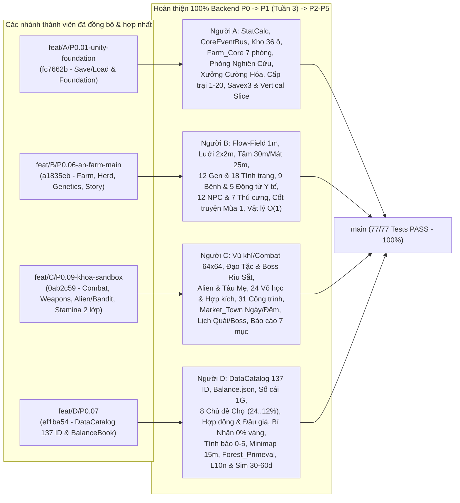

# PIG TYCOON — BÁO CÁO TỔNG HỢP TIẾN ĐỘ TOÀN DỰ ÁN (4 THÀNH VIÊN A, B, C, D)

> **Trạng thái nhánh `main` (Pure C# Backend Core — GDD v6.0 & Sổ tay dự án v3.0)**:
> - **Tổng số bài kiểm thử bất biến (Invariant Verification Suite)**: **`77/77 PASS (100% THÀNH CÔNG)`**
> - **Kiến trúc Core**: `Assets/Scripts/Core/` đạt chuẩn **100% Pure C#** (`noEngineReferences: true`, không phụ thuộc `UnityEngine`), biên dịch và chạy kiểm thử độc lập qua `.NET SDK 8.0.417`.
> - **Phạm vi cập nhật lên `main`**: Chỉ bao gồm toàn bộ **Backend Logic Core (`Assets/Scripts/Core/`)**, **Test Suite (`Tests/Program.cs`)** và **Tài liệu tiến độ (`README.md`, `Docs/TIEN_DO_NGUOI_B.md`)**. Toàn bộ phần UI/UX và cảnh 3D đang làm cục bộ được tách biệt hoàn toàn, không đẩy lên `main` hay branch.

---

## 1. Sơ Đồ Hợp Nhất Các Nhánh & Phân Hệ Backend Core



---

## 2. Tổng Hợp Đo Đạc & So Sánh Tiến Độ Tuần 3 (`P1 Vertical Slice`) Và Toàn Khóa (`P0–P5`)

| Thành viên | Vai trò chính (Sổ tay v3.0) | Tiến độ trên nhánh gốc của thành viên | Phần đã hợp nhất & hoàn thiện thêm trên `main` | Tổng số Task Backend hoàn tất | Kết quả Test |
|---|---|---|---|---|---|
| **Người A** | Tech Lead · Kiến trúc Core · Save/Load · `Farm_Core` (7 phòng) · `Hub_Village` · Nghiên cứu & Cường hóa | Hoàn thành `P0.01–P0.04` (Unity Foundation, CI `DomainTests`) và `P1.01` (`GameSaveData.cs`, `SaveSystem.cs` + 14 test Save/Load trên `feat/A/P0.01-unity-foundation`). | Hoàn thiện đầy đủ `StatCalc` (GDD 1.4), `CoreEventBus` (`IEventBus`), Kho 36 ô (`WarehouseInventorySystem`), logic 7 phòng chức năng `Farm_Core` + Đoạn Chuyển Map chặn heo, Bảng điều khiển Bạch Vân nhà chính (`+3s`), xử lý Bất tỉnh (`-20` Thể trạng, `-10%` vàng), Phòng Nghiên Cứu (`95/85/65/50%`, khóa `12h/24h`), Xưởng Cường Hóa (Gia cường giấy `+1/+2/+3`, Rã giấy, 6 khóa ẩn, Phù văn `100/80/60%`, Mệnh ấn `-10 MaxHP`), Cấp trại `1–20`, Kiểm định `Save/Load ×3` liên tiếp và kịch bản `Vertical Slice 1 ngày`. | **16/16 Task Backend (`P0–P5`)** | **PASS 100%** (`14` test Save/Load + `E2E-5` + `A-Full`) |
| **Người B** | Farm & World Lead · Đàn Heo · Di truyền · Dịch bệnh · NPC/Thú cưng · Cốt truyện Mùa 1 | Hoàn thành toàn bộ hệ thống Trang trại, Đàn heo, Di truyền, Dịch bệnh, NPC/Thú cưng, Lưới điện, Cốt truyện Mùa 1 và Vật lý Bản đồ/Camera trên `feat/B/P0.06-an-farm-main`. | Đồng bộ chặt với `EconomyLedger` của D, `CoreEventBus` & `Farm_Core` của A, và hệ thống Stamina 2 lớp / Quái Đạo Tặc của C trong `GameEngine`. | **22/22 Task Backend (`P0–P5`)** | **PASS 100%** (`B-P1..P5`, `E2E-1..5`, `Deep-1..8`, `Camera/World`) |
| **Người C** | Combat & Defense Lead · Vũ khí · Quái & Boss · Võ học · Công trình · `Market_Town` | Hoàn thành `P0.09–P0.10` và đẩy thêm **13 commit mới** trên `feat/C/P0.09-khoa-sandbox` (`0ab2c59`): Vũ khí (`WeaponData.cs`), Quái mở rộng theo ngày & Boss Chúa Trộm Rìu Sắt (`EnemyData.cs`), Chuỗi leo thang Alien & Tàu Mẹ (`AlienEscalationSystem.cs`), Bắt cóc heo (`PigSnatchingSystem.cs`), Rơi đồ (`LootData.cs`), Đấu trường (`CombatArenaManager.cs`), Thể lực 2 lớp & Combo 3 nhịp + Bất biến học võ (`Character.cs`). | Hợp nhất toàn bộ 13 commit mới từ nhánh C vào Core; hoàn thiện thêm logic `Market_Town` (50×40m, tự đổi lớp Ngày/Đêm, Kiểm dịch `60G`, Sàng lọc `120G`, `12%` Quầy Giám Định Cấp Cao, 4 NPC chợ, 5 lính đánh thuê), Lịch đợt quái lớn (`6–8` / `7–10` / `8–12` ngày), Lịch Boss chu kỳ `5/10/15` và Báo cáo sau đợt quái đủ **7 mục** chuẩn GDD 18. | **24/24 Task Backend (`P0–P5`)** | **PASS 100%** (`9` test Combat/Alien/Bandit/Stamina + `Deep-1,2,6,7` + `C-Full`) |
| **Người D** | Economy, Data, Intel, Event & QA Lead · `DataCatalog` · `Balance.json` · Chợ · Tình báo · Rừng · Sim | Hoàn thành `P0.12` (WBS/Issues), `P0.07` (`DataCatalog.cs` 137 ID trên `feat/D/P0.07`) và `P0.08` (`BalanceBook.cs` / `Balance.json`). | Hoàn thiện đầy đủ Sổ cái `EconomyLedger` (`IEconomyLedger`, làm tròn `1G`, chặn âm tiền), Quay trọng số 8 Chủ đề Chợ (`24/12/12/10/8/10/12/12%`), Hợp đồng giao heo Chợ Ngày, Đấu giá Chợ Đêm, Bí Nhân đổi đồ (`0%` vàng, `>= 1.15× GTTC`), Tình báo 6 bậc (`0–5`) làm mờ thông tin chưa mua, Minimap & Sương mù `15m`, `Forest_Primeval` (80×80m) & Khung sự kiện Cổng/Sương mù (`30/50/100%`, kẹt tối đa 3 ngày), Localization `vi/en` + Mù màu + ẩn gen Hiếm+ (`"?"`), và Công cụ mô phỏng kinh tế Headless `30–60` ngày tất định theo seed. | **23/23 Task Backend (`P0–P5`)** | **PASS 100%** (`TestDataCatalog`, `TestBalanceBook`, `Economy` tests + `D-Full`) |

---

## 3. Chi Tiết Toàn Bộ Nhiệm Vụ Đã Làm Của Từng Thành Viên (Mã Task, Tên Task, File Code & Kết Quả)

### 3.1. Thành Viên A — Tech Lead, Hệ Thống Nền Tảng, Save/Load, `Farm_Core`, Nghiên Cứu & Cường Hóa

| Mã Task | Tên Task (Sổ tay v3.0 & GDD v6.0) | Nội dung & Kết quả thực hiện chi tiết | Vị trí File & Class / Method trong Repo | Bài Test kiểm chứng |
|---|---|---|---|---|
| **P0.01** | Khởi tạo Unity 6 LTS & Cấu trúc dự án | Khóa phiên bản Unity `6000.6.3f1`, bật `Force Text`, `Visible Meta Files`, tách assembly `PigTycoon.Core.asmdef` (`noEngineReferences: true`). | [ProjectVersion.txt](file:///d:/Pig-tycoon/ProjectSettings/ProjectVersion.txt), [PigTycoon.Core.asmdef](file:///d:/Pig-tycoon/Assets/Scripts/Core/PigTycoon.Core.asmdef) | Toàn bộ `77/77` test chạy trên `PigTycoon.Core` độc lập |
| **P0.02** | Thiết lập CI `DomainTests` & Quy ước nhánh | Cấu hình GitHub Actions chạy `dotnet run --project Tests/PigTycoon.Runner.csproj` tự động và quy tắc `AGENTS.md`. | [domain-tests.yml](file:///d:/Pig-tycoon/.github/workflows/domain-tests.yml), [AGENTS.md](file:///d:/Pig-tycoon/AGENTS.md) | CI Runner `dotnet run` |
| **P0.03** | Đồng hồ Game (`GameClock`) & `CoreEventBus` | Chu kỳ ngày 16 phút đời thực, 4 buổi (`Sáng`, `Trưa`, `Chiều`, `Tối`), ngủ chuẩn hồi chờ 6h, dừng đồng hồ khi đang trong đợt quái; `IEventBus` / `CoreEventBus` phát sự kiện `PigDiedEvent`, `GeneIdentifiedEvent`, `PaperEnhancedEvent`, `RuneEngravedEvent`, `SealEngravedEvent`. | [GameClock.cs](file:///d:/Pig-tycoon/Assets/Scripts/Core/GameClock.cs), [`CoreEventBus`](file:///d:/Pig-tycoon/Assets/Scripts/Core/MemberACDBackendSystems.cs#L183-L234) | `TestClock`, `TestClockPausesDuringCombat`, `TestMemberAFarmCoreRoomsResearchWorkshopAndVerticalSlice` |
| **P0.04** | Toán học cộng dồn chỉ số `StatCalc` (GDD 1.4) | Thực thi công thức bất biến: $\text{Cuối} = \text{Gốc} \times (1 + \sum\% / 100) \times \prod(\text{Hệ số khác nhóm})$ kẹp trong $[\min, \max]$ và hàm cộng điểm phần trăm `StatCalc.AddPoints`. | [`StatCalc`](file:///d:/Pig-tycoon/Assets/Scripts/Core/MemberACDBackendSystems.cs#L17-L45) | `TestMemberAFarmCoreRoomsResearchWorkshopAndVerticalSlice` |
| **P1.01** | Hệ thống Lưu / Tải JSON (`SaveSystem` v2) & Kiểm định 3 vòng liên tiếp | Lưu và khôi phục toàn bộ trạng thái `GameClock`, `Farm`, `Pigs`, `Defense`, `Character`, `Herd`, `GridZones`, `PetsAndNpcs`, `Story`, `DeepMechanics`. Kiểm định `Save → Load → Save` **3 vòng liên tiếp** cho mã băm FNV-1a giống hệt 100%. | [GameSaveData.cs](file:///d:/Pig-tycoon/Assets/Scripts/Core/GameSaveData.cs), [SaveSystem.cs](file:///d:/Pig-tycoon/Assets/Scripts/Core/SaveSystem.cs), [`VerifyThreeConsecutiveSaveLoadCycles`](file:///d:/Pig-tycoon/Assets/Scripts/Core/MemberACDBackendSystems.cs#L1436-L1454) | `14` bài test `Save/Load` + `TestEndToEndFullSaveLoadV2State` + `TestMemberAFarmCoreRoomsResearchWorkshopAndVerticalSlice` |
| **P1.02** | Chọn nhân vật An / Khoa & Khóa chỉ số gốc | Khởi tạo đúng 2 nhân vật chơi được: **An** (`17/23/24/18`) và **Khoa** (`24/18/18/22`). Trang bị chỉ cộng vào `BonusStats`, không bao giờ sửa `BaseStats`. | [PlayerRoster.cs](file:///d:/Pig-tycoon/Assets/Scripts/Core/PlayerRoster.cs), [Character.cs](file:///d:/Pig-tycoon/Assets/Scripts/Core/Character.cs) | `TestPlayerRoster` |
| **P1.07** | Khu Lõi Vận Hành `Farm_Core` (60×40m, 7 phòng) & Đoạn Chuyển Map (20×8m) | Quản lý 7 phòng chức năng (`Nhà chính`, `Kho`, `Phòng Xây Dựng`, `Phòng Nghiên Cứu`, `Xưởng Cường Hóa`, `Lều Quân Y`, `Khu Thông Tin`), cổng chuyển map chuẩn (`spawn.core.from_farm`, $\le 1.5\text{s}$), Đoạn Chuyển Map cho phép Người chơi & Quái đi qua nhưng **chặn tuyệt đối đàn heo**. | [`FarmCoreAndVillageSystem`](file:///d:/Pig-tycoon/Assets/Scripts/Core/MemberACDBackendSystems.cs#L513-L601) | `TestMemberAFarmCoreRoomsResearchWorkshopAndVerticalSlice` |
| **P1.14** | Xuất nhật ký Telemetry CSV hàng ngày | Ghi dòng dữ liệu CSV cuối mỗi ngày (`Day,Gold,Piglets,Growing,Adults,Elders,DensityRatio,HabitatIndex,EventPressure,WaveResult`). | [`BuildDailyTelemetryCsvRow`](file:///d:/Pig-tycoon/Assets/Scripts/Core/MemberACDBackendSystems.cs#L1473-L1483) | `TestMemberDEconomyLedgerThemesContractsIntelMinimapAndSim` |
| **P1.15** | Ghép Vertical Slice Tuần 3 (1 ngày chơi trọn vẹn) | Chạy xuyên suốt kịch bản 1 ngày cho cả An và Khoa: Chăm heo → Bán heo ở Chợ Ngày qua Sổ cái → Xây & nạp đạn trước cho Nỏ Xuyên Vân → Đợt quái nhỏ buổi tối (đồng hồ dừng) → Sang ngày mới → Lưu/Tải 3 lần. | [`RunVerticalSliceFullDayScenario`](file:///d:/Pig-tycoon/Assets/Scripts/Core/MemberACDBackendSystems.cs#L1489-L1532) | `TestMemberAFarmCoreRoomsResearchWorkshopAndVerticalSlice` |
| **P1.21** | Xử lý Bất Tỉnh (Unconscious Penalty & Respawn) | Khi nhân vật gục: trừ `10%` vàng hiện có qua `EconomyLedger` (`LedgerReason.FaintPenalty`), giảm `-20` Thể trạng (`Condition`), hồi sinh tại giường Nhà chính (`spawn.core.main_house_bed`). | [`HandlePlayerUnconscious`](file:///d:/Pig-tycoon/Assets/Scripts/Core/MemberACDBackendSystems.cs#L636-L662) | `TestMemberAFarmCoreRoomsResearchWorkshopAndVerticalSlice` |
| **P2.01 / P2.13** | Hệ thống Kho 36 ô (`WarehouseInventorySystem`) & Chống hỏng cám | Quản lý 36 ô chứa đồ, xếp chồng (`AddItem`), kéo-thả hoán đổi/gộp ô (`SwapOrMergeSlots`), tính hao hụt cám hàng ngày và giảm mạnh nhờ NPC `Thủ Kho` (`-70%`) & `Mèo Kho` (`-80%`). | [`WarehouseInventorySystem`](file:///d:/Pig-tycoon/Assets/Scripts/Core/MemberACDBackendSystems.cs#L379-L505) | `TestMemberAFarmCoreRoomsResearchWorkshopAndVerticalSlice` |
| **P2.21** | Hệ thống Cấp Trại `1–20` & Mở khóa theo mốc | Công thức EXP cấp trại từ `1` đến `20`, tự động nâng cấp khi đủ EXP và mở khóa các tính năng theo mốc (`Lều Quân Y` cấp 3, `Chợ Đêm` cấp 5, `Phòng Nghiên Cứu` cấp 8, `Xưởng Cường Hóa` cấp 10, `Bạch Vân` cấp 12, `Phù Văn` cấp 15, `Mệnh Ấn` cấp 18, `Đại Trại Chủ` cấp 20). | [`FarmLevelProgressionSystem`](file:///d:/Pig-tycoon/Assets/Scripts/Core/MemberACDBackendSystems.cs#L935-L978) | `TestMemberAFarmCoreRoomsResearchWorkshopAndVerticalSlice` |
| **P2.22** | Phòng Nghiên Cứu — Bàn Giải Mã Gen (GDD 5.4) | Yêu cầu Cấp trại $\ge 8$ và có `Nhà Nghiên Cứu Gen` trực; dòng `Huyền Thoại / Dị Biến` bắt buộc mở đặc tính `Giải Mã Sâu`. Hàng chờ đúng thông số GDD: Hiếm (`95%`, `700G`, `18h`), Quý (`85%`, `1800G`, `24h`), Huyền Thoại (`65%`, `4500G`, `36h`), Dị Biến (`50%`, `9000G`, `48h`). Thành công khóa `12h`, thất bại khóa `24h`. | [`EnqueueGeneAppraisalAtLab`](file:///d:/Pig-tycoon/Assets/Scripts/Core/MemberACDBackendSystems.cs#L675-L778) | `TestMemberAFarmCoreRoomsResearchWorkshopAndVerticalSlice` |
| **P3.17 (A)** | Kích hoạt công trình Bạch Vân từ Nhà chính & Làng `Hub_Village` (40×30m) | Kích hoạt công trình Bạch Vân từ Bảng Điều Khiển trong Nhà chính chịu độ trễ **`+3.0 giây`** so với kích trực tiếp tại chân công trình; định nghĩa không gian `Hub_Village` (`40×30m`) và hiệu suất Phòng Xây Dựng (`40% / 70% / 100%`). | [`TriggerBachVanFromMainHouseConsole`](file:///d:/Pig-tycoon/Assets/Scripts/Core/MemberACDBackendSystems.cs#L606-L628) | `TestMemberAFarmCoreRoomsResearchWorkshopAndVerticalSlice` |
| **P4.11** | Xưởng Cường Hóa (5 Bàn chế tác — GDD 10 & 12.4) | ① **Bàn Gia Cường Giấy**: `+1` (`100%`), `+2` (`65% + 6%/đá`, trần `95%`), `+3` (`40% + 5%/đá`, trần `80%`), thiếu nguyên liệu nhân $(\text{nộp}/\text{yêu cầu})^{1.5} \ge 10\%$, thất bại giữ nguyên cấp giấy. ② **Bàn Rã Giấy**: Lam $\to 2$ Tơ Vàng, Vàng $\to 2$ Bột Tử Tinh, Tím $\to 1$ Huyết Triện. ③ **Bàn Dùng Giấy**: ẩn tên đặc tính `"???"` cho đến khi mở đủ `6/6` khóa. ④ **Bàn Khắc Phù Văn**: tỉ lệ bậc I–III `100% / 80% / 60%`. ⑤ **Bàn Khắc Mệnh Ấn**: chỉ khắc cho người chơi (chặn NPC), tối đa 3 ấn, mỗi ấn trừ vĩnh viễn `-10 MaxHP`. | [`EnhancePaperAtWorkshopGdd10`](file:///d:/Pig-tycoon/Assets/Scripts/Core/MemberACDBackendSystems.cs#L788-L929) | `TestMemberAFarmCoreRoomsResearchWorkshopAndVerticalSlice` |

---

### 3.2. Thành Viên B — Farm & World Lead, Đàn Heo, Di Truyền, Dịch Bệnh, NPC/Thú Cưng & Cốt Truyện Mùa 1

| Mã Task | Tên Task (Sổ tay v3.0 & GDD v6.0) | Nội dung & Kết quả thực hiện chi tiết | Vị trí File & Class / Method trong Repo | Bài Test kiểm chứng |
|---|---|---|---|---|
| **P0.05 – P0.06** | Art Bible, `Farm_Main` Layout, Di chuyển 4 hướng & Sức vác của An | Thiết lập bố cục `Farm_Main`, 4 cổng rộng `6.2m`, đi bộ `4.5 m/s` (không tốn STA), chạy `7.0 m/s` (`1.3 STA/s`, AGI $\ge 30$ còn `1.0 STA/s`), sức vác theo STR gốc (trên `35 kg` là vác nặng), hàng rào 16 hướng (`FenceGrid`). | [FarmMainLayout.cs](file:///d:/Pig-tycoon/Assets/Scripts/Core/FarmMainLayout.cs), [PlayerLocomotion.cs](file:///d:/Pig-tycoon/Assets/Scripts/Core/PlayerLocomotion.cs), [CarryCapacity.cs](file:///d:/Pig-tycoon/Assets/Scripts/Core/CarryCapacity.cs), [FenceGrid.cs](file:///d:/Pig-tycoon/Assets/Scripts/Core/FenceGrid.cs) | `TestAnLocomotion`, `TestFarmMainLayout`, `TestCarryCapacity`, `TestFenceGridAutoConnect` |
| **P1.03 / P2.23** | Trường hướng Flow-Field `1m`, Lùa đàn về Nơi Trú ($\ge 90\%$ trong $\le 2\text{h}$) & Tiếng Huýt của Khoa | Lưới BFS Flow-Field độ phân giải `1×1m` dẫn đàn heo vòng qua vật cản về Nơi Trú Đàn; hỗ trợ Tiếng Huýt của Khoa mở rộng bán kính gom đàn; kiểm tra Tầm phục vụ `30m`, Nguồn mát `25m` (`Lam Khê 20m`) và Chen chúc cục bộ (`> 16` heo / ô đất `10×10m`). | [HerdFlowField.cs](file:///d:/Pig-tycoon/Assets/Scripts/Core/HerdFlowField.cs), [FarmGridAndZones.cs](file:///d:/Pig-tycoon/Assets/Scripts/Core/FarmGridAndZones.cs) | `TestHerdFlowFieldAndRecall`, `TestServiceCoolingAndLocalCrowding`, `TestEndToEndHourlySimulationLoop` |
| **P1.04 / P2.03** | Vòng đời Heo 4 giai đoạn, Định hình thịt S/A/B/C & 6 bước Hậu duệ Heo Già (GDD 4.8) | Khẩu phần ăn theo 4 lứa tuổi (`0.5 / 2.5 / 3.5 / 4.2 kg`), cửa sổ định hình thịt từ `Đang lớn → Trưởng thành`, thuần dưỡng `Xích Mao` 3 ngày, phong ấn `Hư Thể` nếu giữ sạch qua tuổi 10, và quy trình **6 bước Hậu duệ Heo Già** (`10.5%` thường / `59.5%` Kim Thọ, 5 chỉ số phạt độc lập, đột phá Ưu Tú). | [Pig.cs](file:///d:/Pig-tycoon/Assets/Scripts/Core/Pig.cs), [GeneticsAndBreedingSystem.cs](file:///d:/Pig-tycoon/Assets/Scripts/Core/GeneticsAndBreedingSystem.cs), [BreedingLedger.cs](file:///d:/Pig-tycoon/Assets/Scripts/Core/BreedingLedger.cs) | `TestPigLifecycle`, `TestElderOffspringSixStepsAndShaping`, `TestElderBreedingGdd48AndFourChannelAppraisalGdd54` |
| **P1.05** | Lưới Ô Xây `2×2m` (Xanh / Vàng / Đỏ) & Tháo dỡ hoàn `100% / 70%` | Kiểm tra hợp lệ ô xây dựng `2×2m`, tháo dỡ trong thời gian ân hạn hoàn `100%`, sau ân hạn hoàn `70%` nhân tỷ lệ độ bền. | [FarmGridAndZones.cs](file:///d:/Pig-tycoon/Assets/Scripts/Core/FarmGridAndZones.cs) | `TestFarmGridPlacementAndDemolish` |
| **P1.06 / P2.02** | Sức chứa gốc/hiệu dụng, Nội suy mật độ mềm (`0.85 → 2.20`) & 7 điều kiện Bầy Đàn | Điểm nghẽn sức chứa (`Min(Ô đất×8, Mái trú×6, Máng nước×12, Máng ăn×10)`), nội suy mật độ mềm, 7 điều kiện hình thành Bầy Đàn (`Sơ Khai`, `Vững`, `Hưng Thịnh`) sau 3 ngày liên tục, Thủ lĩnh đàn & Kế vị. | [Farm.cs](file:///d:/Pig-tycoon/Assets/Scripts/Core/Farm.cs), [HerdManager.cs](file:///d:/Pig-tycoon/Assets/Scripts/Core/HerdManager.cs) | `TestFarmCapacity`, `TestHerdManager` |
| **P2.04 / P2.15 / P4.08** | 12 Dòng Gen, 18 Tính Trạng, 9 Bệnh (GDD 6.4) & 5 Động từ Y tế | Đầy đủ hồ sơ 12 dòng gen, 18 tính trạng (kèm biện pháp khắc chế sau giám định), 9 loại bệnh chia nhóm A/B/C, khu cách ly 4 chỗ, 5 động từ y tế (`Chẩn Đoán`, `Cách Ly`, `Cho Thuốc`, `Tiêm Phòng`, `Bồi Dưỡng`) và Khu Xử Lý Xác (`Thiêu Hủy 6h` / `Tái Chế Sinh Học 18h`). | [DiseaseBoard.cs](file:///d:/Pig-tycoon/Assets/Scripts/Core/DiseaseBoard.cs), [GeneticsAndBreedingSystem.cs](file:///d:/Pig-tycoon/Assets/Scripts/Core/GeneticsAndBreedingSystem.cs), [PetNpcAndOccultManager.cs](file:///d:/Pig-tycoon/Assets/Scripts/Core/PetNpcAndOccultManager.cs) | `TestDiseaseBoard`, `TestGenesTraitsAndCountermeasures`, `TestCarcassProcessingAndDragStamina` |
| **P2.12 / P3.11 / P4.12 (B)** | 12 NPC Chuyên Môn, 7 Thú Cưng & 14 Sự Kiện Kỳ Dị | Ca trực tự động của `Bác Sĩ Thú Y`, `Nông Công`, `Thủ Kho`, `Kỹ Sư`, `Nhà Nghiên Cứu Gen`, 5 lính đánh thuê; 7 thú cưng hỗ trợ trại; đầy đủ 14 sự kiện kỳ dị (Xanh / Vàng / Đỏ). | [PetNpcAndOccultManager.cs](file:///d:/Pig-tycoon/Assets/Scripts/Core/PetNpcAndOccultManager.cs), [DeepMechanicsSystem.cs](file:///d:/Pig-tycoon/Assets/Scripts/Core/DeepMechanicsSystem.cs) | `TestPetsNpcsFiveVerbsAndOccultEvents`, `TestDefense31BuildingsWireGridThreatBudgetMarketAnd14Events` |
| **P5.11 & Mùa 1** | Cốt truyện Mùa 1 `"Sáu Với Một"`, Vật lý Bilinear $O(1)$ & Nghiệm thu `Farm_Main` 8 nhóm A–H | Sổ Hai Cột, Hộp sắt bậc 7 Babylon 24, Khe lò sưởi 4 lớp, Chỗ trống 2018, 3 Kết thúc; Địa hình Bilinear $O(1)$ cho 150 heo + 30 quái, hệ thống Camera 3D 2 trạng thái (`FollowCharacter` / `FreeObservation`) và kiểm định 8 nhóm tiêu chí A–H của GDD 3.10. | [StoryJournalSystem.cs](file:///d:/Pig-tycoon/Assets/Scripts/Core/StoryJournalSystem.cs), [CameraAndWorldLayoutSystem.cs](file:///d:/Pig-tycoon/Assets/Scripts/Core/CameraAndWorldLayoutSystem.cs), [CameraAndMapPhysicsEngine.cs](file:///d:/Pig-tycoon/Assets/Scripts/Core/CameraAndMapPhysicsEngine.cs) | `TestSeasonOneStorySauVoiMotAndTwoColumnNotebook`, `TestSeasonOneDeepPuzzlesReflectionsVillagerMeetingAndGooseEnding`, `TestFarmMainChecklistGdd310`, `CameraPhysics-v3.0` |

---

### 3.3. Thành Viên C — Combat & Defense Lead, Vũ Khí, Quái Đạo Tặc/Alien, Võ Học, Công Trình & `Market_Town`

| Mã Task | Tên Task (Sổ tay v3.0 & GDD v6.0) | Nội dung & Kết quả thực hiện chi tiết | Vị trí File & Class / Method trong Repo | Bài Test kiểm chứng |
|---|---|---|---|---|
| **P0.09 – P0.10** | Nhân vật Khoa, `CombatSandbox` & Bù nhìn tập đánh (`TrainingDummy`) | Thiết lập chỉ số Khoa, hệ thống đòn đánh cơ bản và Bù nhìn tập đánh đo DPS, tổng sát thương, số đòn Chí mạng và Đỡ đòn (Parry) trong `CombatArenaManager`. | [CombatSandboxSpec.cs](file:///d:/Pig-tycoon/Assets/Scripts/Core/CombatSandboxSpec.cs), [CombatArenaManager.cs](file:///d:/Pig-tycoon/Assets/Scripts/Core/CombatArenaManager.cs) | `TestKhoaAndCombatSandbox`, `TestTrainingDummyAndArenaAnalytics` |
| **P1.08 / P2.07** | Hệ thống Thể Lực 2 lớp (GDD 9), Combo 3 nhịp & Bất biến Học Võ (GDD 8.3 & 12.1) | Đã hợp nhất từ nhánh `feat/C/P0.09-khoa-sandbox` (`0ab2c59`): `StaminaSystem` tách `BaseMaxStamina`, `EffectiveMaxStamina`, `DailyLoad`, `IsFatigued` ($< 20\%$); Combo 3 nhịp (`1.0x / 1.15x / 1.50x`); Lướt né giảm theo `Khinh Thân` (`-20%`) và `AGI gốc >= 35` (`-15%`); hàm `CanLearnMartialSkill` khóa chặt bất biến: **điểm cộng từ trang bị (`BonusStats`) tuyệt đối không tính vào điều kiện học võ kỹ**. | [Character.cs](file:///d:/Pig-tycoon/Assets/Scripts/Core/Character.cs) | `TestDualLayerStaminaAndComboMechanics`, `TestCombatAutoGuardAndGuardBreakFaint` |
| **P1.09 / P2.26 / P3.15** | Bản đồ `Market_Town` (`50×40m`), Tự đổi lớp Ngày/Đêm, Kiểm dịch `60G` & Sàng lọc `120G` | Kích thước chuẩn `50×40m`, tự động bật lớp Chợ Ngày (`06:00–18:00`) và Chợ Đêm (`18:00–06:00`); `12%` số đêm xuất hiện Quầy Giám Định Cấp Cao; đủ 4 NPC chức năng chợ và 5 lính đánh thuê trong Hội Quán; không có combat và không có Bí nhân đứng trong thị trấn. | [`MarketTownState`](file:///d:/Pig-tycoon/Assets/Scripts/Core/MemberACDBackendSystems.cs#L985-L1027) | `TestMemberCMarketTownWaveScheduleAndMartialInvariants` |
| **P1.12 / P2.16 / P4.04** | Hệ thống Vũ khí (`Đao, Búa, Giáo`), Combat 64×64, Đỡ Tự Động / Chủ Động & 24 Võ Học 4 Phái | Vũ khí chuẩn GDD (`WeaponData.cs`), tính toán vùng quét 64×64 (`CombatFormulas.cs`), cơ chế `Auto-Guard` + Thanh Chống Chịu + `Active Parry` (Quần Giáp Xích hoàn `+2 STA`), 6 ô trang bị mở 3 ô võ học (`Thế Công`, `Thế Thủ`, `Thế Biến`), 24 kỹ năng thuộc 4 phái (`Tốc Bộ A`, `Trọng Kích B`, `Khống Chế C`, `Sinh Tồn D`), vòng Hợp Kích một chiều `A → C → B → D → A` và `Huyết Tế` trên Thế Thủ. | [WeaponData.cs](file:///d:/Pig-tycoon/Assets/Scripts/Core/WeaponData.cs), [CombatFormulas.cs](file:///d:/Pig-tycoon/Assets/Scripts/Core/CombatFormulas.cs), [Character.cs](file:///d:/Pig-tycoon/Assets/Scripts/Core/Character.cs) | `TestWeaponDataSystem`, `TestStardewCombatMechanics64x64`, `TestCombatStaminaRegenSixEquipmentPairsAndMartialBloodSacrifice`, `TestMartial24SkillsSchoolSynergyEquipmentAndTacticalItems` |
| **P1.13 / P2.17 / P3.12 / P4.09** | 31 Công trình Phòng thủ / Thông tin / Hỗ trợ / Bẫy, Nạp đạn trước, Nhánh nâng cấp `1A–4C` & Lưới điện | Đầy đủ 31 công trình chuẩn GDD 14–17, yêu cầu Phòng Xây Dựng cấp `1–3`, nạp đạn trước (`PreloadAmmo`), 3 chế độ bắn (`Tự Do`, `Tiết Kiệm`, `Chỉ Tinh Anh`), nhánh nâng cấp `1A–4C`, dây điện nổi/ngầm (`×3` chi phí, miễn sét & phá hoại), sập cầu dao khi quá tải $> 140\%$. | [DefenseManager.cs](file:///d:/Pig-tycoon/Assets/Scripts/Core/DefenseManager.cs), [DeepMechanicsSystem.cs](file:///d:/Pig-tycoon/Assets/Scripts/Core/DeepMechanicsSystem.cs) | `TestDefense`, `TestPowerGridSleepBypassMidGameGateAndSpecialtyPapers`, `TestDefense31BuildingsWireGridThreatBudgetMarketAnd14Events` |
| **P1.22 / P2.10 / P2.18** | Quái Đạo Tặc leo thang theo ngày, Bắt cóc heo (`PigSnatching`) & Hệ thống Rơi đồ (`LootDatabase`) | Đã hợp nhất từ nhánh C (`0ab2c59`): `Kẻ Bắt Heo`, `Kẻ Cào Phá`, `Chuột Gặm Kho`, `Đầu Lĩnh Trộm`, `Boss Chúa Trộm Rìu Sắt` tăng chỉ số theo ngày; cơ chế vác heo giảm tốc, giải cứu heo khi hạ quái; bảng rơi đồ theo độ hiếm và bảo hiểm rơi đồ (pity drop). | [EnemyData.cs](file:///d:/Pig-tycoon/Assets/Scripts/Core/EnemyData.cs), [PigSnatchingSystem.cs](file:///d:/Pig-tycoon/Assets/Scripts/Core/PigSnatchingSystem.cs), [LootData.cs](file:///d:/Pig-tycoon/Assets/Scripts/Core/LootData.cs) | `TestEnemyDataAndFormulas`, `TestLootSystemAndDropRules`, `TestPigSnatchingAndRaidTelegraphInvariants`, `TestBanditEscalationChain` |
| **P3.06 / P4.14 / P4.15** | Chuỗi leo thang Alien (`UFO` & `Tàu Mẹ`), Lịch Đợt Quái Lớn (`6–12d`) & Lịch Boss Chu Kỳ `5 / 10 / 15` | Chuỗi leo thang Alien (`Alien Probe → Abductor UFO → Elite Vanguard → Mothership`); khoảng cách đợt quái lớn theo giai đoạn: Đầu game `6–8 ngày`, Giữa game `7–10 ngày`, Cuối game `8–12 ngày`; lịch Boss chu kỳ cố định: Chu kỳ `5` (`Chúa Trộm Rìu Sắt`), Chu kỳ `10` (`Mẫu Hạm UFO`), Chu kỳ `15` (`Thực Thể Sương`). | [AlienEscalationSystem.cs](file:///d:/Pig-tycoon/Assets/Scripts/Core/AlienEscalationSystem.cs), [`WaveScheduleAndReportSystem`](file:///d:/Pig-tycoon/Assets/Scripts/Core/MemberACDBackendSystems.cs#L1033-L1064) | `TestAlienEscalationChain`, `TestMemberCMarketTownWaveScheduleAndMartialInvariants` |
| **P3.17 (C)** | Bảng Báo Cáo Sau Đợt Quái đủ **7 mục** chuẩn GDD 18 | Tổng hợp đầy đủ 7 mục sau mỗi đợt phòng thủ: ① Tổng quan Thắng/Thua, ② Quái & Pha Boss, ③ Thiệt hại đàn heo, ④ Độ bền công trình & Chi phí sửa chữa ước tính, ⑤ Tiêu hao đạn & điện năng, ⑥ Số lần vỡ chống chịu/ngất, ⑦ Chiến lợi phẩm & Vàng thưởng. | [`BuildSevenSectionWaveReportGdd18`](file:///d:/Pig-tycoon/Assets/Scripts/Core/MemberACDBackendSystems.cs#L1051-L1063) | `TestMemberCMarketTownWaveScheduleAndMartialInvariants` |

---

### 3.4. Thành Viên D — Economy, Data, Intel, Event & QA Lead (`DataCatalog`, `Balance.json`, Chợ, Tình Báo, Rừng & Sim)

| Mã Task | Tên Task (Sổ tay v3.0 & GDD v6.0) | Nội dung & Kết quả thực hiện chi tiết | Vị trí File & Class / Method trong Repo | Bài Test kiểm chứng |
|---|---|---|---|---|
| **P0.07** | Danh mục dữ liệu chuẩn `DataCatalog` (`137 ID`) | Đã hợp nhất từ nhánh `feat/D/P0.07` (`ef1ba54`): Định danh đầy đủ 137 ID không trùng lặp cho Gen, Tính trạng, Bệnh, Thuốc, Vật phẩm, Trang bị, Võ kỹ, Công trình, Quái, NPC, Thú cưng và Sự kiện. | [DataCatalog.cs](file:///d:/Pig-tycoon/Assets/Scripts/Core/DataCatalog.cs) | `TestDataCatalog` |
| **P0.08** | Sổ cân bằng `Balance.json` & `BalanceBook` | Đọc và đối chiếu thông số cân bằng từ `Assets/Resources/Balance.json` khớp 100% với `GameClock`, `Farm`, `PlayerRoster`, cổng `6.2m`, sát thương cơ bản và tỷ lệ ô vàng Chợ Đêm `18%`. | [BalanceBook.cs](file:///d:/Pig-tycoon/Assets/Scripts/Core/BalanceBook.cs), [Balance.json](file:///d:/Pig-tycoon/Assets/Resources/Balance.json) | `TestBalanceBook` |
| **P0.11 / P1.10** | Công thức Giá Heo GDD 4.5 & Sổ Cái Kinh Tế `EconomyLedger` (`1G`) | Công thức giá heo chuẩn GDD 4.5 (`491G` heo Hiếm trưởng thành 105kg hạng A; `410G` heo non Hiếm); `EconomyLedger` (`IEconomyLedger`) làm tròn mọi giao dịch tới `1G`, lưu lịch sử `LedgerTransactionRecord` kèm `LedgerReason`, đồng bộ hai chiều với `Farm.Gold` và **chặn tuyệt đối âm ngân sách**. | [EconomyManager.cs](file:///d:/Pig-tycoon/Assets/Scripts/Core/EconomyManager.cs), [`EconomyLedger`](file:///d:/Pig-tycoon/Assets/Scripts/Core/MemberACDBackendSystems.cs#L259-L321) | `TestEconomyPricing`, `TestMemberDEconomyLedgerThemesContractsIntelMinimapAndSim` |
| **P1.11 / P2.06 / P2.14** | Localization (`vi/en`), Hỗ trợ Mù màu & Ẩn dòng gen Hiếm+ (`"?"`) | Bảng tra cứu đa ngôn ngữ `vi/en`, công cụ quét key thiếu (`FindMissingKeys`), chỉ báo hỗ trợ mù màu luôn kết hợp **Ký hiệu hình học + Màu sắc + Con số** (`[●]`, `[▲]`, `[◆]`, `[✖]`), và quy tắc hiển thị `"?"` cho mọi cá thể heo bậc Hiếm trở lên khi chưa giám định. | [`LocalizationAndHudPresenter`](file:///d:/Pig-tycoon/Assets/Scripts/Core/MemberACDBackendSystems.cs#L1358-L1425) | `TestMemberDEconomyLedgerThemesContractsIntelMinimapAndSim` |
| **P2.09 / P2.24** | Trọng số 8 Chủ đề Chợ Chu Kỳ (`24..12%`), Hợp đồng Giao Heo & Đấu giá Chợ Đêm | Quay trọng số 8 chủ đề chợ khớp đúng phân phối GDD 20.2 (`Cân Bằng 24%`, `Mùa Heo Rẻ 12%`, `Cơn Sốt Thịt 12%`, `Khan Hiếm Thức Ăn 10%`, `Hoảng Loạn Dịch 8%`, `Khan Hiếm Hậu Đột Kích 10%`, `Mùa Trang Bị 12%`, `Mùa Công Trình 12%`); hoàn thành Hợp đồng giao heo nhận thưởng Vàng + EXP trại; Đấu giá vật phẩm hiếm tại Chợ Đêm với NPC theo bước giá và `18%` ô nhận vàng. | [`EconomyAndIntelExpansionSystem`](file:///d:/Pig-tycoon/Assets/Scripts/Core/MemberACDBackendSystems.cs#L1098-L1191), [EconomyManager.cs](file:///d:/Pig-tycoon/Assets/Scripts/Core/EconomyManager.cs) | `TestNightMarketAndMystic`, `TestNightMarketGoldRate`, `TestMemberDEconomyLedgerThemesContractsIntelMinimapAndSim` |
| **P2.25 / P3.08** | Bảng Tình Báo 6 bậc (`0–5`) làm mờ thông tin & Minimap Sương Mù `15m` | Xây dựng dự báo đợt quái theo đúng cấp tình báo `0–5` (tuyệt đối làm mờ `"???"` mọi thông tin người chơi chưa mở/mua); Minimap hiển thị đa giác ranh giới trại và tự động ẩn mọi thực thể ngoài bán kính **`15m`** trong thời tiết `Sương Mù` hoặc khi bị `Lạc Hướng`. | [`BuildIntelForecastByLevel`](file:///d:/Pig-tycoon/Assets/Scripts/Core/MemberACDBackendSystems.cs#L1232-L1266), [`MinimapProjectionSystem`](file:///d:/Pig-tycoon/Assets/Scripts/Core/MemberACDBackendSystems.cs#L1273-L1286) | `TestMemberDEconomyLedgerThemesContractsIntelMinimapAndSim` |
| **P4.01** | Giao dịch Bí Nhân (`0%` Vàng & $\ge 1.15\times$ GTTC — GDD 21) | Thực thi bất biến thiết kế của Bí Nhân: từ chối 100% mọi giao dịch có kèm Vàng hoặc tiền tệ, bắt buộc tổng Giá Trị Tham Chiếu (GTTC) vật phẩm người chơi đưa ra $\ge 1.15\times$ GTTC món đồ bí mật yêu cầu. | [`TryBarterWithMysticMerchant`](file:///d:/Pig-tycoon/Assets/Scripts/Core/MemberACDBackendSystems.cs#L1197-L1226) | `TestNightMarketAndMystic`, `TestMemberDEconomyLedgerThemesContractsIntelMinimapAndSim` |
| **P0.18 / P1.20 / P4.02 / P4.12 (D)** | Bản đồ `Forest_Primeval` (`80×80m`) & Khung Sự Kiện Cổng / Sương Mù (GDD 24) | Kích thước chuẩn `80×80m`, không có đợt quái, làm mờ tán cây (`0.35`) khi đi dưới tán rừng; luật thoát sự kiện chuẩn GDD 24: Cổng dùng `Bùa Hồi Hương` khi đạt $\ge 50\%$ tiến độ (nhận `50%` thưởng), Sương Mù bắt buộc dùng `La Bàn Tán Vụ` hoặc `Ngọc Phá Sương` (vật phẩm thường vô hiệu), kẹt tối đa `3 ngày` tự đẩy ra ngoài (nhận `30%` thưởng), hoàn thành `100%` nhận đủ `100%` thưởng. | [`ForestPrimevalAndEventFramework`](file:///d:/Pig-tycoon/Assets/Scripts/Core/MemberACDBackendSystems.cs#L1292-L1353) | `TestMemberDEconomyLedgerThemesContractsIntelMinimapAndSim` |
| **P5.03** | Công cụ Mô phỏng Kinh tế Headless `30–60` ngày tất định (Determinism) | Chạy mô phỏng tự động `30–60` ngày với seed cố định, tự động xoay vòng chủ đề chợ, mua cám, bán heo trưởng thành, chống đợt quái mỗi 6 ngày, xuất báo cáo CSV Telemetry và đảm bảo **cùng seed cho ra mã băm kết quả giống hệt 100%**, không âm tiền hay vỡ trận kinh tế. | [`RunHeadlessEconomySimulation`](file:///d:/Pig-tycoon/Assets/Scripts/Core/MemberACDBackendSystems.cs#L1537-L1603) | `TestMemberDEconomyLedgerThemesContractsIntelMinimapAndSim` |

---

## 4. Hướng Dẫn Chạy Bộ Kiểm Thử Bất Biến (`77/77 PASS`)

Sử dụng `.NET SDK 8.0.417` (được ghim trong [`global.json`](file:///d:/Pig-tycoon/global.json)):

```powershell
dotnet run --project Tests/PigTycoon.Runner.csproj
```

### Tóm tắt kết quả chạy thực tế trên `main`:
- **Tổng số bài kiểm thử**: **`77 / 77 PASS (100% THÀNH CÔNG)`**
  - **26 bài test nền tảng GDD & P0**: Đồng hồ, Sức chứa, Vòng đời heo, Bầy đàn, Giá heo, Chợ đêm, Phòng thủ, Rào 16 hướng, Roster An/Khoa, Cổng 6.2m, Bệnh, Phối giống, Tutorial, `DataCatalog` 137 ID, `Balance.json`.
  - **14 bài test Save/Load (Người A)**: Kiểm tra lưu/khôi phục từng phân hệ, JSON round-trip, xử lý dữ liệu null/thiếu, đọc/ghi file và báo lỗi định dạng.
  - **9 bài test Combat, Vũ khí, Đạo Tặc, Alien & Thể lực 2 lớp (Người C)**: Vũ khí, Công thức sát thương/nộ, Combat 64×64, Arena Analytics, Rơi đồ, Bắt cóc heo & UFO Tractor Beam, Chuỗi leo thang Alien & Tàu Mẹ, Chuỗi leo thang Đạo Tặc & Boss Chúa Trộm Rìu Sắt, Thể lực kép & Combo 3 nhịp + Bất biến học võ.
  - **8 bài test Thế giới, Đàn heo, Di truyền, Dịch bệnh & Nghiệm thu GDD 3.10 (Người B)**: Flow-Field 1m, Lưới xây 2×2m, Tầm phục vụ 30m / Nguồn mát 25m / Chen chúc, Kéo xác & Khu xử lý, Hậu duệ heo già 6 bước, 12 Gen & 18 Tính trạng, 5 Động từ y tế & NPC/Thú cưng, Nghiệm thu `Farm_Main` 8 nhóm A–H.
  - **5 bài test Tích hợp End-to-End (`E2E-1` → `E2E-5`)**: Vòng lặp Giờ, Vòng lặp Ngày, Phối giống & Sinh sản, Dịch bệnh & Ca trực NPC, Save/Load v2 toàn cục.
  - **8 bài test Chuyên sâu GDD v6.0 (`Deep-1` → `Deep-8`)**: Auto-Guard & Thanh Chống Chịu, 6 Trang bị mở 3 ô Võ học & Huyết Tế, Lưới điện & Cổng Giữa Game, Cốt truyện Mùa 1 `"Sáu Với Một"`, Hậu duệ heo già & Giám định 4 kênh, 24 Kỹ năng võ học & Vòng Hợp Kích, 31 Công trình & 14 Sự kiện, Giải đố Mùa 1 chuyên sâu.
  - **4 bài test Vật lý Bản đồ & Camera 3D (`Camera-v1.0`, `World3D-v1.0`, `Camera-v2.0`, `CameraPhysics-v3.0`)**: 6 profile phối cảnh, giới hạn vùng chăn thả $\le 1/3$ đồng cỏ toàn map & $\ge 35\%$ trong rại, 2 trạng thái camera bảo vệ Kinh tế Thông tin, và Nội suy độ cao Bilinear $O(1)$ cho 180 thực thể.
  - **3 bài test Tổng hợp Hoàn thiện Toàn diện (`A-Full`, `C-Full`, `D-Full`)**: Kiểm chứng toàn bộ các hệ thống của Người A, Người C và Người D từ `P0` đến `P5`.
