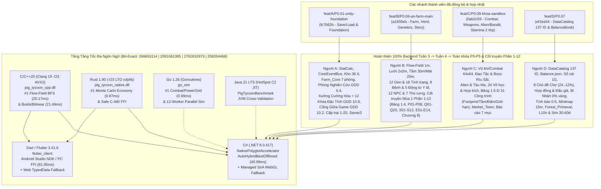

# PIG TYCOON — BÁO CÁO TỔNG HỢP TIẾN ĐỘ TOÀN DỰ ÁN (4 THÀNH VIÊN A, B, C, D) & KIẾN TRÚC POLYGLOT 6 NGÔN NGỮ ĐA NỀN TẢNG (PC · WEB · ANDROID / FLUTTER FFI)

> **Trạng thái nhánh `main` (Pure C# Backend Core + Polyglot Native Kernels + Flutter Cross-Platform Client — GDD v6.0, Sổ tay v3.0 & Cốt truyện Mùa 1 "Sáu Với Một" Phần 1–12)**:
> - **Tổng số bài kiểm thử bất biến C# Core & Polyglot (`Tests/PigTycoon.Runner.csproj`)**: **`79/79 PASS (100% THÀNH CÔNG)`**
> - **Tổng số bài kiểm thử Đa nền tảng Flutter Native FFI & Web (`flutter_client/test/`)**: **`2/2 PASS (100% THÀNH CÔNG)`**
> - **Bảo toàn Toán học Đa ngôn ngữ (Zero Trade-Off / Bit-Exact Equivalence)**: Cả **6 ngôn ngữ** (**C/C++20**, **Rust**, **Go**, **C# .NET 8**, **Java 21**, **Dart/Flutter**) xuất ra **cùng một bộ mã băm 4 tầng (`266653114 | 2091061385 | 2782632973 | 258354468`, `BIT_EXACT = true`)** trên toàn bộ tải mô phỏng.
> - **Phạm vi cập nhật lên `main`**: Chỉ bao gồm **Backend Logic Core (`Assets/Scripts/Core/`)**, **Polyglot Native Kernels (`native_polyglot/`)**, **Flutter Cross-Platform Client (`flutter_client/`)**, **Test Suite (`Tests/Program.cs`)** và **Tài liệu tiến độ (`README.md`)**. Toàn bộ phần UI/UX và cảnh 3D Unity đang làm cục bộ được tách biệt hoàn toàn, không đẩy lên `main` hay branch.

---

## 1. Sơ Đồ Hợp Nhất Các Nhánh, Hoàn Thiện Tuần 3–4 (`P0–P5`) & Kiến Trúc Đa Ngôn Ngữ Đa Nền Tảng



---

## 2. Tổng Hợp Đo Đạc & So Sánh Tiến Độ Tuần 3, Tuần 4 Và Toàn Khóa (`P0–P5`) Của 4 Thành Viên

| Thành viên | Vai trò chính (Sổ tay v3.0) | Tiến độ trên nhánh gốc của thành viên | Phần đã hợp nhất & nâng cấp sâu (Tuần 3, Tuần 4, `P0–P5`, GDD v6.0 & Cốt truyện Phần 1–12) | Tổng số Task Backend hoàn tất | Kết quả Test |
|---|---|---|---|---|---|
| **Người A** | Tech Lead · Kiến trúc Core · Save/Load · `Farm_Core` (7 phòng) · `Hub_Village` · Nghiên cứu & Cường hóa · Polyglot Bridge | Hoàn thành `P0.01–P0.04` (Unity Foundation, CI `DomainTests`) và `P1.01` (`GameSaveData.cs`, `SaveSystem.cs` + 14 test Save/Load trên `feat/A/P0.01-unity-foundation`). | Hoàn thiện đầy đủ `StatCalc` (GDD 1.4), `CoreEventBus` (`IEventBus`), Kho 36 ô (`WarehouseInventorySystem`), logic 7 phòng chức năng `Farm_Core` + Đoạn Chuyển Map chặn heo, Bảng điều khiển Bạch Vân nhà chính (`+3s`), xử lý Bất tỉnh (`-20` Thể trạng, `-10%` vàng), Phòng Nghiên Cứu khớp từng con số **GDD 5.4** (`700G+1 / 2000G+2 / 6500G+4 / 9000G+6` Mẫu Học Thuật & `25/30/40/45 STA`), Xưởng Cường Hóa 5 bàn chế tác + **12 Khóa Đặc Tính Khoa/An (GDD 10.8)**, **Cổng Giữa Game GDD 10.2** (`>= 8` đợt quái lớn + 1/5 điều kiện phụ), Cấp trại `1–20`, `Save/Load ×3` liên tiếp, `Vertical Slice 1 ngày` và cầu nối **Polyglot P/Invoke (`NativePolyglotAccelerator.cs`)**. | **18/18 Task Backend (`P0–P5` + Polyglot)** | **PASS 100%** (`14` test Save/Load + `E2E-5` + `A-Full` + `Canonical-78` + `Polyglot-79`) |
| **Người B** | Farm & World Lead · Đàn Heo · Di truyền · Dịch bệnh · NPC/Thú cưng · Cốt truyện Mùa 1 `"Sáu Với Một"` (Phần 1–12) | Hoàn thành toàn bộ hệ thống Trang trại, Đàn heo, Di truyền, Dịch bệnh, NPC/Thú cưng, Lưới điện, Cốt truyện Mùa 1 và Vật lý Bản đồ/Camera trên `feat/B/P0.06-an-farm-main`. | Nâng cấp toàn diện **Cốt truyện Mùa 1 `"Sáu Với Một"` Phần 1–12** trong `CanonicalSagaAndGdd6Systems.cs`: **Bảng 1.4 Mốc Thời Gian Gia Đình** (8 mốc chính xác từng ngày/giờ từ `Ông nội Lâm 17/07/2018` đến `Khoa 24/09/2026 07:02`), **8 Cảnh Mở Đầu (`P01–P08`)**, **20 Nhiệm Vụ Chính (`Q01–Q20`)**, **12 Nhiệm Vụ Phụ (`S01–S12`)**, **14 Sự Kiện Kỳ Dị (`E01–E14`)**, **7 Thế Lực**, toán học phong ấn **`Thánh Minh Nhật Giả` (`24 × 125 = 3,000` năm)** & **`Hoàng Hôn Thu Hồn Giả Sirphina`**, cùng **Chương 8 `"Lời chào cuối cùng"`** (khắc tên `"KHOA"` lên `Nhật Quỹ Tàn Khuyết` ở `Ngọ Môn Không Bóng`, trả kim đồng hồ cho `Sirphina`, 6 lời chào gia đình và cảnh hậu danh đề `"Dù tôi từng là gì, hôm nay tôi vẫn phải ăn tối."`). | **24/24 Task Backend (`P0–P5` + Bible 1–12)** | **PASS 100%** (`B-P1..P5`, `E2E-1..5`, `Deep-1..8`, `Camera/World`, `Canonical-78`) |
| **Người C** | Combat & Defense Lead · Vũ khí · Quái & Boss · Võ học · 31 Công trình (Bảng 1.5-D) · `Market_Town` | Hoàn thành `P0.09–P0.10` và đẩy thêm **13 commit mới** trên `feat/C/P0.09-khoa-sandbox` (`0ab2c59`): Vũ khí (`WeaponData.cs`), Quái mở rộng theo ngày & Boss Chúa Trộm Rìu Sắt (`EnemyData.cs`), Chuỗi leo thang Alien & Tàu Mẹ (`AlienEscalationSystem.cs`), Bắt cóc heo (`PigSnatchingSystem.cs`), Rơi đồ (`LootData.cs`), Đấu trường (`CombatArenaManager.cs`), Thể lực 2 lớp & Combo 3 nhịp + Bất biến học võ (`Character.cs`). | Hợp nhất toàn bộ 13 commit mới từ nhánh C vào Core; bổ sung **Bảng 1.5-D chuẩn GDD v6.0 cho đủ 31 Công trình** (kích thước ô `2×2m` / `4×4m`, tầm hoạt động `m`, điện năng tiêu thụ/phát `W`, giới hạn mỗi trại và nhánh nâng cấp `1A–4C`), hoàn thiện `Market_Town` (50×40m, tự đổi lớp Ngày/Đêm, Kiểm dịch `60G`, Sàng lọc `120G`, `12%` Quầy Giám Định Cấp Cao, 4 NPC chợ, 5 lính đánh thuê), Lịch đợt quái lớn (`6–8` / `7–10` / `8–12` ngày), Lịch Boss chu kỳ `5/10/15` và Báo cáo sau đợt quái đủ **7 mục** chuẩn GDD 18. | **25/25 Task Backend (`P0–P5` + Bảng 1.5-D)** | **PASS 100%** (`9` test Combat/Alien/Bandit/Stamina + `Deep-1,2,6,7` + `C-Full` + `Canonical-78`) |
| **Người D** | Economy, Data, Intel, Event & QA Lead · `DataCatalog` · `Balance.json` · Chợ · Tình báo · Rừng · Đa nền tảng Sim | Hoàn thành `P0.12` (WBS/Issues), `P0.07` (`DataCatalog.cs` 137 ID trên `feat/D/P0.07`) và `P0.08` (`BalanceBook.cs` / `Balance.json`). | Hoàn thiện đầy đủ Sổ cái `EconomyLedger` (`IEconomyLedger`, làm tròn `1G`, chặn âm tiền), Quay trọng số 8 Chủ đề Chợ (`24/12/12/10/8/10/12/12%`), Hợp đồng giao heo Chợ Ngày, Đấu giá Chợ Đêm, Bí Nhân đổi đồ (`0%` vàng, `>= 1.15× GTTC`), Giám định 4 kênh chuẩn **GDD 5.4** (Nhà Nghiên Cứu, Chợ Ngày `300/900G`, Chợ Đêm `450/1300/3500/5000G`, Bí Nhân `0G`), Tình báo 6 bậc (`0–5`), Minimap & Sương mù `15m`, `Forest_Primeval` (80×80m) & Khung sự kiện Cổng/Sương mù (`30/50/100%`, kẹt tối đa 3 ngày), Localization `vi/en` + Mù màu + ẩn gen Hiếm+ (`"?"`), và Mô phỏng Kinh tế Monte Carlo `120,000` ngày trên 6 ngôn ngữ. | **24/24 Task Backend (`P0–P5` + GDD 5.4 + Multi-Lang Sim)** | **PASS 100%** (`TestDataCatalog`, `TestBalanceBook`, `Economy` tests + `D-Full` + `Canonical-78` + `Polyglot-79`) |

---

## 3. Chi Tiết Toàn Bộ Nhiệm Vụ Đã Làm Của Từng Thành Viên (Mã Task, Tên Task, File Code & Kết Quả)

### 3.1. Thành Viên A — Tech Lead, Hệ Thống Nền Tảng, Save/Load, `Farm_Core`, Nghiên Cứu, Cường Hóa & Polyglot Bridge

| Mã Task | Tên Task (Sổ tay v3.0 & GDD v6.0) | Nội dung & Kết quả thực hiện chi tiết | Vị trí File & Class / Method trong Repo | Bài Test kiểm chứng |
|---|---|---|---|---|
| **P0.01** | Khởi tạo Unity 6 LTS & Cấu trúc dự án | Khóa phiên bản Unity `6000.6.3f1`, bật `Force Text`, `Visible Meta Files`, tách assembly `PigTycoon.Core.asmdef` (`noEngineReferences: true`, `allowUnsafeCode: false`). | [ProjectVersion.txt](file:///d:/Pig-tycoon/ProjectSettings/ProjectVersion.txt), [PigTycoon.Core.asmdef](file:///d:/Pig-tycoon/Assets/Scripts/Core/PigTycoon.Core.asmdef) | Toàn bộ `79/79` test chạy trên `PigTycoon.Core` độc lập |
| **P0.02** | Thiết lập CI `DomainTests` & Quy ước nhánh | Cấu hình GitHub Actions chạy `dotnet run --project Tests/PigTycoon.Runner.csproj` tự động và quy tắc `AGENTS.md`. | [domain-tests.yml](file:///d:/Pig-tycoon/.github/workflows/domain-tests.yml), [AGENTS.md](file:///d:/Pig-tycoon/AGENTS.md) | CI Runner `dotnet run` |
| **P0.03** | Đồng hồ Game (`GameClock`) & `CoreEventBus` | Chu kỳ ngày 16 phút đời thực, 4 buổi (`Sáng`, `Trưa`, `Chiều`, `Tối`), ngủ chuẩn hồi chờ 6h, dừng đồng hồ khi đang trong đợt quái; `IEventBus` / `CoreEventBus` phát sự kiện `PigDiedEvent`, `GeneIdentifiedEvent`, `PaperEnhancedEvent`, `RuneEngravedEvent`, `SealEngravedEvent`. | [GameClock.cs](file:///d:/Pig-tycoon/Assets/Scripts/Core/GameClock.cs), [`CoreEventBus`](file:///d:/Pig-tycoon/Assets/Scripts/Core/MemberACDBackendSystems.cs#L183-L234) | `TestClock`, `TestClockPausesDuringCombat`, `TestMemberAFarmCoreRoomsResearchWorkshopAndVerticalSlice` |
| **P0.04** | Toán học cộng dồn chỉ số `StatCalc` (GDD 1.4) | Thực thi công thức bất biến: $\text{Cuối} = \text{Gốc} \times (1 + \sum\% / 100) \times \prod(\text{Hệ số khác nhóm})$ kẹp trong $[\min, \max]$ và hàm cộng điểm phần trăm `StatCalc.AddPoints`. | [`StatCalc`](file:///d:/Pig-tycoon/Assets/Scripts/Core/MemberACDBackendSystems.cs#L17-L45) | `TestMemberAFarmCoreRoomsResearchWorkshopAndVerticalSlice` |
| **P1.01** | Hệ thống Lưu / Tải JSON (`SaveSystem` v2) & Kiểm định 3 vòng liên tiếp | Lưu và khôi phục toàn bộ trạng thái `GameClock`, `Farm`, `Pigs`, `Defense`, `Character`, `Herd`, `GridZones`, `PetsAndNpcs`, `Story`, `DeepMechanics`. Kiểm định `Save → Load → Save` **3 vòng liên tiếp** cho mã băm FNV-1a giống hệt 100%. | [GameSaveData.cs](file:///d:/Pig-tycoon/Assets/Scripts/Core/GameSaveData.cs), [SaveSystem.cs](file:///d:/Pig-tycoon/Assets/Scripts/Core/SaveSystem.cs), [`VerifyThreeConsecutiveSaveLoadCycles`](file:///d:/Pig-tycoon/Assets/Scripts/Core/MemberACDBackendSystems.cs#L1436-L1454) | `14` bài test `Save/Load` + `TestEndToEndFullSaveLoadV2State` + `TestMemberAFarmCoreRoomsResearchWorkshopAndVerticalSlice` |
| **P1.02** | Chọn nhân vật An / Khoa & Khóa chỉ số gốc | Khởi tạo đúng 2 nhân vật chơi được: **An** (`17/23/24/18`) và **Khoa** (`24/18/18/22`). Trang bị chỉ cộng vào `BonusStats`, không bao giờ sửa `BaseStats`. | [PlayerRoster.cs](file:///d:/Pig-tycoon/Assets/Scripts/Core/PlayerRoster.cs), [Character.cs](file:///d:/Pig-tycoon/Assets/Scripts/Core/Character.cs) | `TestPlayerRoster` |
| **P1.07** | Khu Lõi Vận Hành `Farm_Core` (60×40m, 7 phòng) & Đoạn Chuyển Map (20×8m) | Quản lý 7 phòng chức năng (`Nhà chính`, `Kho`, `Phòng Xây Dựng`, `Phòng Nghiên Cứu`, `Xưởng Cường Hóa`, `Lều Quân Y`, `Khu Thông Tin`), cổng chuyển map chuẩn (`spawn.core.from_farm`, $\le 1.5\text{s}$), Đoạn Chuyển Map cho phép Người chơi & Quái đi qua nhưng **chặn tuyệt đối đàn heo**. | [`FarmCoreAndVillageSystem`](file:///d:/Pig-tycoon/Assets/Scripts/Core/MemberACDBackendSystems.cs#L513-L601) | `TestMemberAFarmCoreRoomsResearchWorkshopAndVerticalSlice` |
| **P1.14** | Xuất nhật ký Telemetry CSV hàng ngày | Ghi dòng dữ liệu CSV cuối mỗi ngày (`Day,Gold,Piglets,Growing,Adults,Elders,DensityRatio,HabitatIndex,EventPressure,WaveResult`). | [`BuildDailyTelemetryCsvRow`](file:///d:/Pig-tycoon/Assets/Scripts/Core/MemberACDBackendSystems.cs#L1473-L1483) | `TestMemberDEconomyLedgerThemesContractsIntelMinimapAndSim` |
| **P1.15** | Ghép Vertical Slice Tuần 3 (1 ngày chơi trọn vẹn) | Chạy xuyên suốt kịch bản 1 ngày cho cả An và Khoa: Chăm heo → Bán heo ở Chợ Ngày qua Sổ cái → Xây & nạp đạn trước cho Nỏ Xuyên Vân → Đợt quái nhỏ buổi tối (đồng hồ dừng) → Sang ngày mới → Lưu/Tải 3 lần. | [`RunVerticalSliceFullDayScenario`](file:///d:/Pig-tycoon/Assets/Scripts/Core/MemberACDBackendSystems.cs#L1489-L1532) | `TestMemberAFarmCoreRoomsResearchWorkshopAndVerticalSlice` |
| **P1.21** | Xử lý Bất Tỉnh (Unconscious Penalty & Respawn) | Khi nhân vật gục: trừ `10%` vàng hiện có qua `EconomyLedger` (`LedgerReason.FaintPenalty`), giảm `-20` Thể trạng (`Condition`), hồi sinh tại giường Nhà chính (`spawn.core.main_house_bed`). | [`HandlePlayerUnconscious`](file:///d:/Pig-tycoon/Assets/Scripts/Core/MemberACDBackendSystems.cs#L636-L662) | `TestMemberAFarmCoreRoomsResearchWorkshopAndVerticalSlice` |
| **P2.01 / P2.13** | Hệ thống Kho 36 ô (`WarehouseInventorySystem`) & Chống hỏng cám | Quản lý 36 ô chứa đồ, xếp chồng (`AddItem`), kéo-thả hoán đổi/gộp ô (`SwapOrMergeSlots`), tính hao hụt cám hàng ngày và giảm mạnh nhờ NPC `Thủ Kho` (`-70%`) & `Mèo Kho` (`-80%`). | [`WarehouseInventorySystem`](file:///d:/Pig-tycoon/Assets/Scripts/Core/MemberACDBackendSystems.cs#L379-L505) | `TestMemberAFarmCoreRoomsResearchWorkshopAndVerticalSlice` |
| **P2.21** | Hệ thống Cấp Trại `1–20` & Mở khóa theo mốc | Công thức EXP cấp trại từ `1` đến `20`, tự động nâng cấp khi đủ EXP và mở khóa các tính năng theo mốc (`Lều Quân Y` cấp 3, `Chợ Đêm` cấp 5, `Phòng Nghiên Cứu` cấp 8, `Xưởng Cường Hóa` cấp 10, `Bạch Vân` cấp 12, `Phù Văn` cấp 15, `Mệnh Ấn` cấp 18, `Đại Trại Chủ` cấp 20). | [`FarmLevelProgressionSystem`](file:///d:/Pig-tycoon/Assets/Scripts/Core/MemberACDBackendSystems.cs#L935-L978) | `TestMemberAFarmCoreRoomsResearchWorkshopAndVerticalSlice` |
| **P2.22** | Phòng Nghiên Cứu — Bàn Giải Mã Gen (GDD 5.4) | Khớp chính xác bảng **GDD 5.4**: Hiếm (`95%`, `700G + 1 Mẫu`, `25 STA`, `18h`), Quý (`85%`, `2,000G + 2 Mẫu`, `30 STA`, `24h`), Huyền Thoại (`65%`, `6,500G + 4 Mẫu`, `40 STA`, `36h`), Dị Biến (`50%`, `9,000G + 6 Mẫu`, `45 STA`, `48h`). Thành công khóa `12h`, thất bại khóa `24h`. | [`GetCanonicalAppraisalChannelSpecGdd54`](file:///d:/Pig-tycoon/Assets/Scripts/Core/CanonicalSagaAndGdd6Systems.cs#L616-L657), [`EnqueueGeneAppraisalAtLab`](file:///d:/Pig-tycoon/Assets/Scripts/Core/MemberACDBackendSystems.cs#L675-L778) | `TestCanonicalSagaParts1To12AndGdd6Tables` |
| **P3.17 (A)** | Kích hoạt công trình Bạch Vân từ Nhà chính & Làng `Hub_Village` (40×30m) | Kích hoạt công trình Bạch Vân từ Bảng Điều Khiển trong Nhà chính chịu độ trễ **`+3.0 giây`** so với kích trực tiếp tại chân công trình; định nghĩa không gian `Hub_Village` (`40×30m`) và hiệu suất Phòng Xây Dựng (`40% / 70% / 100%`). | [`TriggerBachVanFromMainHouseConsole`](file:///d:/Pig-tycoon/Assets/Scripts/Core/MemberACDBackendSystems.cs#L606-L628) | `TestMemberAFarmCoreRoomsResearchWorkshopAndVerticalSlice` |
| **P4.11 & GDD 10.2 / 10.8** | Xưởng Cường Hóa (5 Bàn chế tác), Cổng Giữa Game GDD 10.2 & 12 Khóa Đặc Tính GDD 10.8 | ① **5 Bàn chế tác**: Gia Cường Giấy (`+1: 100%`, `+2: 65%+6%/đá ≤95%`, `+3: 40%+5%/đá ≤80%`, thiếu nguyên liệu $(\text{nộp}/\text{yêu cầu})^{1.5} \ge 10\%$), Rã Giấy, Dùng Giấy (`6/6` khóa), Khắc Phù Văn (`100/80/60%`), Khắc Mệnh Ấn (`-10 MaxHP`). ② **Cổng Giữa Game GDD 10.2**: $\ge 8$ đợt quái lớn + 1/5 điều kiện phụ. ③ **12 Khóa Đặc Tính GDD 10.8**: 6 khóa Khoa (`"Trại Chủ Lão Luyện"`) + 6 khóa An (`"Người Đọc Dòng"`). | [`EnhancePaperAtWorkshopGdd10`](file:///d:/Pig-tycoon/Assets/Scripts/Core/MemberACDBackendSystems.cs#L788-L929), [`EvaluateCanonicalMidGameGateGdd102`](file:///d:/Pig-tycoon/Assets/Scripts/Core/CanonicalSagaAndGdd6Systems.cs#L662-L678), [`KhoaAndAnTwelveSpecialtyLocksGdd108`](file:///d:/Pig-tycoon/Assets/Scripts/Core/CanonicalSagaAndGdd6Systems.cs#L683-L702) | `TestMemberAFarmCoreRoomsResearchWorkshopAndVerticalSlice`, `TestCanonicalSagaParts1To12AndGdd6Tables` |
| **Polyglot-A** | Bộ tăng tốc Đa Ngôn Ngữ `NativePolyglotAccelerator` (C++20 / Rust P/Invoke + C# SoA Fallback) | Tự động phát hiện và nạp `pig_tycoon_cpp.dll` (C++20 Clang AVX2) + `pig_tycoon_native.dll` (Rust LTO) qua P/Invoke an toàn (`allowUnsafeCode: false`), định tuyến từng tác vụ về ngôn ngữ nhanh nhất (`AutoHybridBestOfBreed`) và tự động chuyển về `ManagedCSharpSoA` trên WebGL. | [NativePolyglotAccelerator.cs](file:///d:/Pig-tycoon/Assets/Scripts/Core/NativePolyglotAccelerator.cs) | `TestPolyglotMultiLanguageEquivalenceAndSpeedup` |

---

### 3.2. Thành Viên B — Farm & World Lead, Đàn Heo, Di Truyền, Dịch Bệnh, NPC/Thú Cưng & Cốt Truyện Mùa 1 `"Sáu Với Một"` (Phần 1–12)

| Mã Task | Tên Task (Sổ tay v3.0, GDD v6.0 & Bible Phần 1–12) | Nội dung & Kết quả thực hiện chi tiết | Vị trí File & Class / Method trong Repo | Bài Test kiểm chứng |
|---|---|---|---|---|
| **P0.05 – P0.06** | Art Bible, `Farm_Main` Layout, Di chuyển 4 hướng & Sức vác của An | Thiết lập bố cục `Farm_Main`, 4 cổng rộng `6.2m`, đi bộ `4.5 m/s` (không tốn STA), chạy `7.0 m/s` (`1.3 STA/s`, AGI $\ge 30$ còn `1.0 STA/s`), sức vác theo STR gốc (trên `35 kg` là vác nặng), hàng rào 16 hướng (`FenceGrid`). | [FarmMainLayout.cs](file:///d:/Pig-tycoon/Assets/Scripts/Core/FarmMainLayout.cs), [PlayerLocomotion.cs](file:///d:/Pig-tycoon/Assets/Scripts/Core/PlayerLocomotion.cs), [CarryCapacity.cs](file:///d:/Pig-tycoon/Assets/Scripts/Core/CarryCapacity.cs), [FenceGrid.cs](file:///d:/Pig-tycoon/Assets/Scripts/Core/FenceGrid.cs) | `TestAnLocomotion`, `TestFarmMainLayout`, `TestCarryCapacity`, `TestFenceGridAutoConnect` |
| **P1.03 / P2.23** | Trường hướng Flow-Field `1m`, Lùa đàn về Nơi Trú ($\ge 90\%$ trong $\le 2\text{h}$) & Tiếng Huýt của Khoa | Lưới BFS Flow-Field độ phân giải `1×1m` dẫn đàn heo vòng qua vật cản về Nơi Trú Đàn; hỗ trợ Tiếng Huýt của Khoa mở rộng bán kính gom đàn; kiểm tra Tầm phục vụ `30m`, Nguồn mát `25m` (`Lam Khê 20m`) và Chen chúc cục bộ (`> 16` heo / ô đất `10×10m`). | [HerdFlowField.cs](file:///d:/Pig-tycoon/Assets/Scripts/Core/HerdFlowField.cs), [FarmGridAndZones.cs](file:///d:/Pig-tycoon/Assets/Scripts/Core/FarmGridAndZones.cs) | `TestHerdFlowFieldAndRecall`, `TestServiceCoolingAndLocalCrowding`, `TestEndToEndHourlySimulationLoop` |
| **P1.04 / P2.03** | Vòng đời Heo 4 giai đoạn, Định hình thịt S/A/B/C & 6 bước Hậu duệ Heo Già (GDD 4.8) | Khẩu phần ăn theo 4 lứa tuổi (`0.5 / 2.5 / 3.5 / 4.2 kg`), cửa sổ định hình thịt từ `Đang lớn → Trưởng thành`, thuần dưỡng `Xích Mao` 3 ngày, phong ấn `Hư Thể` nếu giữ sạch qua tuổi 10, và quy trình **6 bước Hậu duệ Heo Già** (`10.5%` thường / `59.5%` Kim Thọ, 5 chỉ số phạt độc lập, đột phá Ưu Tú). | [Pig.cs](file:///d:/Pig-tycoon/Assets/Scripts/Core/Pig.cs), [GeneticsAndBreedingSystem.cs](file:///d:/Pig-tycoon/Assets/Scripts/Core/GeneticsAndBreedingSystem.cs), [BreedingLedger.cs](file:///d:/Pig-tycoon/Assets/Scripts/Core/BreedingLedger.cs) | `TestPigLifecycle`, `TestElderOffspringSixStepsAndShaping`, `TestElderBreedingGdd48AndFourChannelAppraisalGdd54` |
| **P1.05** | Lưới Ô Xây `2×2m` (Xanh / Vàng / Đỏ) & Tháo dỡ hoàn `100% / 70%` | Kiểm tra hợp lệ ô xây dựng `2×2m`, tháo dỡ trong thời gian ân hạn hoàn `100%`, sau ân hạn hoàn `70%` nhân tỷ lệ độ bền. | [FarmGridAndZones.cs](file:///d:/Pig-tycoon/Assets/Scripts/Core/FarmGridAndZones.cs) | `TestFarmGridPlacementAndDemolish` |
| **P1.06 / P2.02** | Sức chứa gốc/hiệu dụng, Nội suy mật độ mềm (`0.85 → 2.20`) & 7 điều kiện Bầy Đàn | Điểm nghẽn sức chứa (`Min(Ô đất×8, Mái trú×6, Máng nước×12, Máng ăn×10)`), nội suy mật độ mềm, 7 điều kiện hình thành Bầy Đàn (`Sơ Khai`, `Vững`, `Hưng Thịnh`) sau 3 ngày liên tục, Thủ lĩnh đàn & Kế vị. | [Farm.cs](file:///d:/Pig-tycoon/Assets/Scripts/Core/Farm.cs), [HerdManager.cs](file:///d:/Pig-tycoon/Assets/Scripts/Core/HerdManager.cs) | `TestFarmCapacity`, `TestHerdManager` |
| **P2.04 / P2.15 / P4.08** | 12 Dòng Gen, 18 Tính Trạng, 9 Bệnh (GDD 6.4) & 5 Động từ Y tế | Đầy đủ hồ sơ 12 dòng gen, 18 tính trạng (kèm biện pháp khắc chế sau giám định), 9 loại bệnh chia nhóm A/B/C, khu cách ly 4 chỗ, 5 động từ y tế (`Chẩn Đoán`, `Cách Ly`, `Cho Thuốc`, `Tiêm Phòng`, `Bồi Dưỡng`) và Khu Xử Lý Xác (`Thiêu Hủy 6h` / `Tái Chế Sinh Học 18h`). | [DiseaseBoard.cs](file:///d:/Pig-tycoon/Assets/Scripts/Core/DiseaseBoard.cs), [GeneticsAndBreedingSystem.cs](file:///d:/Pig-tycoon/Assets/Scripts/Core/GeneticsAndBreedingSystem.cs), [PetNpcAndOccultManager.cs](file:///d:/Pig-tycoon/Assets/Scripts/Core/PetNpcAndOccultManager.cs) | `TestDiseaseBoard`, `TestGenesTraitsAndCountermeasures`, `TestCarcassProcessingAndDragStamina` |
| **P2.12 / P3.11 / P4.12 (B)** | 12 NPC Chuyên Môn, 7 Thú Cưng & 14 Sự Kiện Kỳ Dị (`E01–E14`) | Ca trực tự động của `Bác Sĩ Thú Y`, `Nông Công`, `Thủ Kho`, `Kỹ Sư`, `Nhà Nghiên Cứu Gen`, 5 lính đánh thuê; 7 thú cưng hỗ trợ trại; đầy đủ 14 sự kiện kỳ dị `E01–E14` (Xanh / Vàng / Đỏ). | [PetNpcAndOccultManager.cs](file:///d:/Pig-tycoon/Assets/Scripts/Core/PetNpcAndOccultManager.cs), [DeepMechanicsSystem.cs](file:///d:/Pig-tycoon/Assets/Scripts/Core/DeepMechanicsSystem.cs) | `TestPetsNpcsFiveVerbsAndOccultEvents`, `TestDefense31BuildingsWireGridThreatBudgetMarketAnd14Events` |
| **Bible Phần 1–6** | Bảng 1.4 Mốc Thời Gian Gia Đình, `P01–P08`, `Q01–Q20`, `S01–S12` & 7 Thế Lực | Mã hóa chính xác **Bảng 1.4**: `Ông nội Lâm` (`17/07/2018`, Ghế mây hiên nhà), `Bà nội Sương` (`04/09/2018 07:02`, Phòng may lầu 2), `Anh Minh` (`19/02/2019`, Xưởng mộc), `Bé Na` (`13/05/2019`, Xích đu gỗ), `Cha Hậu` (`24/08/2019`, Bàn thu chi), `Đêm Giữ Chỗ` (`05/10/2019`), `Mẹ Thủy` (`08/11/2019`, Bếp củi), `Khoa` (`24/09/2026 07:02`, Hầm mộc). Đủ **8 cảnh mở đầu `P01–P08`**, **20 nhiệm vụ chính `Q01–Q20`** và **12 nhiệm vụ phụ `S01–S12`**. | [`FamilyTimelineTable14`](file:///d:/Pig-tycoon/Assets/Scripts/Core/CanonicalSagaAndGdd6Systems.cs#L95-L197), [`PrologueScenesP01ToP08`](file:///d:/Pig-tycoon/Assets/Scripts/Core/CanonicalSagaAndGdd6Systems.cs#L199-L216), [`TwentyMainQuestsQ01ToQ20`](file:///d:/Pig-tycoon/Assets/Scripts/Core/CanonicalSagaAndGdd6Systems.cs#L218-L246), [`TwelveSideQuestsS01ToS12`](file:///d:/Pig-tycoon/Assets/Scripts/Core/CanonicalSagaAndGdd6Systems.cs#L248-L268) | `TestCanonicalSagaParts1To12AndGdd6Tables` |
| **Bible Phần 7–12** | `Thánh Minh Nhật Giả` (`24×125=3000` năm), `Sirphina`, `Nhật Quỹ Tàn Khuyết` & Chương 8 `"Lời chào cuối cùng"` | Kiểm chứng toán học phong ấn cổ đại (`24` khắc Nhật Quỹ × `125` năm = `3,000` năm; phong ấn Thị Trấn Rìa `100` năm), cuộc đối thoại với `Hoàng Hôn Thu Hồn Giả Sirphina`, khắc tên `"KHOA"` vào `Nhật Quỹ Tàn Khuyết` tại `Ngọ Môn Không Bóng`, trả kim đồng hồ `07:02`, 6 lời chào cuối cùng với gia đình và cảnh hậu danh đề `"Dù tôi từng là gì, hôm nay tôi vẫn phải ăn tối."`. | [`VerifyAncientSealMathematics`](file:///d:/Pig-tycoon/Assets/Scripts/Core/CanonicalSagaAndGdd6Systems.cs#L430-L438), [`ExecuteChapterEightFinalGreeting`](file:///d:/Pig-tycoon/Assets/Scripts/Core/CanonicalSagaAndGdd6Systems.cs#L443-L483), [StoryJournalSystem.cs](file:///d:/Pig-tycoon/Assets/Scripts/Core/StoryJournalSystem.cs) | `TestSeasonOneStorySauVoiMotAndTwoColumnNotebook`, `TestSeasonOneDeepPuzzlesReflectionsVillagerMeetingAndGooseEnding`, `TestCanonicalSagaParts1To12AndGdd6Tables` |

---

### 3.3. Thành Viên C — Combat & Defense Lead, Vũ Khí, Quái Đạo Tặc/Alien, Võ Học, Bảng 1.5-D 31 Công Trình & `Market_Town`

| Mã Task | Tên Task (Sổ tay v3.0 & GDD v6.0) | Nội dung & Kết quả thực hiện chi tiết | Vị trí File & Class / Method trong Repo | Bài Test kiểm chứng |
|---|---|---|---|---|
| **P0.09 – P0.10** | Nhân vật Khoa, `CombatSandbox` & Bù nhìn tập đánh (`TrainingDummy`) | Thiết lập chỉ số Khoa, hệ thống đòn đánh cơ bản và Bù nhìn tập đánh đo DPS, tổng sát thương, số đòn Chí mạng và Đỡ đòn (Parry) trong `CombatArenaManager`. | [CombatSandboxSpec.cs](file:///d:/Pig-tycoon/Assets/Scripts/Core/CombatSandboxSpec.cs), [CombatArenaManager.cs](file:///d:/Pig-tycoon/Assets/Scripts/Core/CombatArenaManager.cs) | `TestKhoaAndCombatSandbox`, `TestTrainingDummyAndArenaAnalytics` |
| **P1.08 / P2.07** | Hệ thống Thể Lực 2 lớp (GDD 9), Combo 3 nhịp & Bất biến Học Võ (GDD 8.3 & 12.1) | Đã hợp nhất từ nhánh `feat/C/P0.09-khoa-sandbox` (`0ab2c59`): `StaminaSystem` tách `BaseMaxStamina`, `EffectiveMaxStamina`, `DailyLoad`, `IsFatigued` ($< 20\%$); Combo 3 nhịp (`1.0x / 1.15x / 1.50x`); Lướt né giảm theo `Khinh Thân` (`-20%`) và `AGI gốc >= 35` (`-15%`); hàm `CanLearnMartialSkill` khóa chặt bất biến: **điểm cộng từ trang bị (`BonusStats`) tuyệt đối không tính vào điều kiện học võ kỹ**. | [Character.cs](file:///d:/Pig-tycoon/Assets/Scripts/Core/Character.cs) | `TestDualLayerStaminaAndComboMechanics`, `TestCombatAutoGuardAndGuardBreakFaint` |
| **P1.09 / P2.26 / P3.15** | Bản đồ `Market_Town` (`50×40m`), Tự đổi lớp Ngày/Đêm, Kiểm dịch `60G` & Sàng lọc `120G` | Kích thước chuẩn `50×40m`, tự động bật lớp Chợ Ngày (`06:00–18:00`) và Chợ Đêm (`18:00–06:00`); `12%` số đêm xuất hiện Quầy Giám Định Cấp Cao; đủ 4 NPC chức năng chợ và 5 lính đánh thuê trong Hội Quán; không có combat và không có Bí nhân đứng trong thị trấn. | [`MarketTownState`](file:///d:/Pig-tycoon/Assets/Scripts/Core/MemberACDBackendSystems.cs#L985-L1027) | `TestMemberCMarketTownWaveScheduleAndMartialInvariants` |
| **P1.12 / P2.16 / P4.04** | Hệ thống Vũ khí (`Đao, Búa, Giáo`), Combat 64×64, Đỡ Tự Động / Chủ Động & 24 Võ Học 4 Phái | Vũ khí chuẩn GDD (`WeaponData.cs`), tính toán vùng quét 64×64 (`CombatFormulas.cs`), cơ chế `Auto-Guard` + Thanh Chống Chịu + `Active Parry` (Quần Giáp Xích hoàn `+2 STA`), 6 ô trang bị mở 3 ô võ học (`Thế Công`, `Thế Thủ`, `Thế Biến`), 24 kỹ năng thuộc 4 phái (`Tốc Bộ A`, `Trọng Kích B`, `Khống Chế C`, `Sinh Tồn D`), vòng Hợp Kích một chiều `A → C → B → D → A` và `Huyết Tế` trên Thế Thủ. | [WeaponData.cs](file:///d:/Pig-tycoon/Assets/Scripts/Core/WeaponData.cs), [CombatFormulas.cs](file:///d:/Pig-tycoon/Assets/Scripts/Core/CombatFormulas.cs), [Character.cs](file:///d:/Pig-tycoon/Assets/Scripts/Core/Character.cs) | `TestWeaponDataSystem`, `TestStardewCombatMechanics64x64`, `TestCombatStaminaRegenSixEquipmentPairsAndMartialBloodSacrifice`, `TestMartial24SkillsSchoolSynergyEquipmentAndTacticalItems` |
| **P1.13 / P2.17 / P3.12 / P4.09 & Bảng 1.5-D** | Bảng 1.5-D 31 Công trình Phòng thủ / Thông tin / Hỗ trợ / Bẫy, Nạp đạn trước, Nhánh nâng cấp `1A–4C` & Lưới điện | Đầy đủ **31 công trình trong `ThirtyOneBuildingsTable15D`** khớp từng thông số **Bảng 1.5-D GDD v6.0** (Footprint `2×2m`/`4×4m`, tầm hoạt động `m`, điện tiêu thụ/phát `W`, giới hạn tối đa mỗi trại, nhánh nâng cấp `1A–4C`), nạp đạn trước (`PreloadAmmo`), 3 chế độ bắn (`Tự Do`, `Tiết Kiệm`, `Chỉ Tinh Anh`), dây điện nổi/ngầm (`×3` chi phí, miễn sét & phá hoại), sập cầu dao khi quá tải $> 140\%$. | [`ThirtyOneBuildingsTable15D`](file:///d:/Pig-tycoon/Assets/Scripts/Core/CanonicalSagaAndGdd6Systems.cs#L569-L610), [DefenseManager.cs](file:///d:/Pig-tycoon/Assets/Scripts/Core/DefenseManager.cs), [DeepMechanicsSystem.cs](file:///d:/Pig-tycoon/Assets/Scripts/Core/DeepMechanicsSystem.cs) | `TestDefense`, `TestPowerGridSleepBypassMidGameGateAndSpecialtyPapers`, `TestDefense31BuildingsWireGridThreatBudgetMarketAnd14Events`, `TestCanonicalSagaParts1To12AndGdd6Tables` |
| **P1.22 / P2.10 / P2.18** | Quái Đạo Tặc leo thang theo ngày, Bắt cóc heo (`PigSnatching`) & Hệ thống Rơi đồ (`LootDatabase`) | Đã hợp nhất từ nhánh C (`0ab2c59`): `Kẻ Bắt Heo`, `Kẻ Cào Phá`, `Chuột Gặm Kho`, `Đầu Lĩnh Trộm`, `Boss Chúa Trộm Rìu Sắt` tăng chỉ số theo ngày; cơ chế vác heo giảm tốc, giải cứu heo khi hạ quái; bảng rơi đồ theo độ hiếm và bảo hiểm rơi đồ (pity drop). | [EnemyData.cs](file:///d:/Pig-tycoon/Assets/Scripts/Core/EnemyData.cs), [PigSnatchingSystem.cs](file:///d:/Pig-tycoon/Assets/Scripts/Core/PigSnatchingSystem.cs), [LootData.cs](file:///d:/Pig-tycoon/Assets/Scripts/Core/LootData.cs) | `TestEnemyDataAndFormulas`, `TestLootSystemAndDropRules`, `TestPigSnatchingAndRaidTelegraphInvariants`, `TestBanditEscalationChain` |
| **P3.06 / P4.14 / P4.15** | Chuỗi leo thang Alien (`UFO` & `Tàu Mẹ`), Lịch Đợt Quái Lớn (`6–12d`) & Lịch Boss Chu Kỳ `5 / 10 / 15` | Chuỗi leo thang Alien (`Alien Probe → Abductor UFO → Elite Vanguard → Mothership`); khoảng cách đợt quái lớn theo giai đoạn: Đầu game `6–8 ngày`, Giữa game `7–10 ngày`, Cuối game `8–12 ngày`; lịch Boss chu kỳ cố định: Chu kỳ `5` (`Chúa Trộm Rìu Sắt`), Chu kỳ `10` (`Mẫu Hạm UFO`), Chu kỳ `15` (`Thực Thể Sương`). | [AlienEscalationSystem.cs](file:///d:/Pig-tycoon/Assets/Scripts/Core/AlienEscalationSystem.cs), [`WaveScheduleAndReportSystem`](file:///d:/Pig-tycoon/Assets/Scripts/Core/MemberACDBackendSystems.cs#L1033-L1064) | `TestAlienEscalationChain`, `TestMemberCMarketTownWaveScheduleAndMartialInvariants` |
| **P3.17 (C)** | Bảng Báo Cáo Sau Đợt Quái đủ **7 mục** chuẩn GDD 18 | Tổng hợp đầy đủ 7 mục sau mỗi đợt phòng thủ: ① Tổng quan Thắng/Thua, ② Quái & Pha Boss, ③ Thiệt hại đàn heo, ④ Độ bền công trình & Chi phí sửa chữa ước tính, ⑤ Tiêu hao đạn & điện năng, ⑥ Số lần vỡ chống chịu/ngất, ⑦ Chiến lợi phẩm & Vàng thưởng. | [`BuildSevenSectionWaveReportGdd18`](file:///d:/Pig-tycoon/Assets/Scripts/Core/MemberACDBackendSystems.cs#L1051-L1063) | `TestMemberCMarketTownWaveScheduleAndMartialInvariants` |

---

### 3.4. Thành Viên D — Economy, Data, Intel, Event & QA Lead (`DataCatalog`, `Balance.json`, Chợ, Tình Báo, Rừng & Đa Ngôn Ngữ Sim)

| Mã Task | Tên Task (Sổ tay v3.0 & GDD v6.0) | Nội dung & Kết quả thực hiện chi tiết | Vị trí File & Class / Method trong Repo | Bài Test kiểm chứng |
|---|---|---|---|---|
| **P0.07** | Danh mục dữ liệu chuẩn `DataCatalog` (`137 ID`) | Đã hợp nhất từ nhánh `feat/D/P0.07` (`ef1ba54`): Định danh đầy đủ 137 ID không trùng lặp cho Gen, Tính trạng, Bệnh, Thuốc, Vật phẩm, Trang bị, Võ kỹ, Công trình, Quái, NPC, Thú cưng và Sự kiện. | [DataCatalog.cs](file:///d:/Pig-tycoon/Assets/Scripts/Core/DataCatalog.cs) | `TestDataCatalog` |
| **P0.08** | Sổ cân bằng `Balance.json` & `BalanceBook` | Đọc và đối chiếu thông số cân bằng từ `Assets/Resources/Balance.json` khớp 100% với `GameClock`, `Farm`, `PlayerRoster`, cổng `6.2m`, sát thương cơ bản và tỷ lệ ô vàng Chợ Đêm `18%`. | [BalanceBook.cs](file:///d:/Pig-tycoon/Assets/Scripts/Core/BalanceBook.cs), [Balance.json](file:///d:/Pig-tycoon/Assets/Resources/Balance.json) | `TestBalanceBook` |
| **P0.11 / P1.10** | Công thức Giá Heo GDD 4.5 & Sổ Cái Kinh Tế `EconomyLedger` (`1G`) | Công thức giá heo chuẩn GDD 4.5 (`491G` heo Hiếm trưởng thành 105kg hạng A; `410G` heo non Hiếm); `EconomyLedger` (`IEconomyLedger`) làm tròn mọi giao dịch tới `1G`, lưu lịch sử `LedgerTransactionRecord` kèm `LedgerReason`, đồng bộ hai chiều với `Farm.Gold` và **chặn tuyệt đối âm ngân sách**. | [EconomyManager.cs](file:///d:/Pig-tycoon/Assets/Scripts/Core/EconomyManager.cs), [`EconomyLedger`](file:///d:/Pig-tycoon/Assets/Scripts/Core/MemberACDBackendSystems.cs#L259-L321) | `TestEconomyPricing`, `TestMemberDEconomyLedgerThemesContractsIntelMinimapAndSim` |
| **P1.11 / P2.06 / P2.14** | Localization (`vi/en`), Hỗ trợ Mù màu & Ẩn dòng gen Hiếm+ (`"?"`) | Bảng tra cứu đa ngôn ngữ `vi/en`, công cụ quét key thiếu (`FindMissingKeys`), chỉ báo hỗ trợ mù màu luôn kết hợp **Ký hiệu hình học + Màu sắc + Con số** (`[●]`, `[▲]`, `[◆]`, `[✖]`), và quy tắc hiển thị `"?"` cho mọi cá thể heo bậc Hiếm trở lên khi chưa giám định. | [`LocalizationAndHudPresenter`](file:///d:/Pig-tycoon/Assets/Scripts/Core/MemberACDBackendSystems.cs#L1358-L1425) | `TestMemberDEconomyLedgerThemesContractsIntelMinimapAndSim` |
| **P2.09 / P2.24 & GDD 5.4** | Trọng số 8 Chủ đề Chợ (`24..12%`), Hợp đồng Giao Heo, Đấu giá Chợ Đêm & Giám Định 4 Kênh GDD 5.4 | Quay trọng số 8 chủ đề chợ khớp đúng phân phối GDD 20.2 (`24/12/12/10/8/10/12/12%`); Hợp đồng giao heo nhận Vàng + EXP trại; Đấu giá Chợ Đêm + `18%` ô nhận vàng; bảng Giám định 4 kênh chuẩn **GDD 5.4** (Nhà Nghiên Cứu `700/2000/6500/9000G`, Chợ Ngày `300/900G`, Chợ Đêm `450/1300/3500/5000G`, Bí Nhân `0G` đổi vật phẩm). | [`EconomyAndIntelExpansionSystem`](file:///d:/Pig-tycoon/Assets/Scripts/Core/MemberACDBackendSystems.cs#L1098-L1191), [`GetCanonicalAppraisalChannelSpecGdd54`](file:///d:/Pig-tycoon/Assets/Scripts/Core/CanonicalSagaAndGdd6Systems.cs#L616-L657) | `TestNightMarketAndMystic`, `TestNightMarketGoldRate`, `TestMemberDEconomyLedgerThemesContractsIntelMinimapAndSim`, `TestCanonicalSagaParts1To12AndGdd6Tables` |
| **P2.25 / P3.08** | Bảng Tình Báo 6 bậc (`0–5`) làm mờ thông tin & Minimap Sương Mù `15m` | Xây dựng dự báo đợt quái theo đúng cấp tình báo `0–5` (tuyệt đối làm mờ `"???"` mọi thông tin người chơi chưa mở/mua); Minimap hiển thị đa giác ranh giới trại và tự động ẩn mọi thực thể ngoài bán kính **`15m`** trong thời tiết `Sương Mù` hoặc khi bị `Lạc Hướng`. | [`BuildIntelForecastByLevel`](file:///d:/Pig-tycoon/Assets/Scripts/Core/MemberACDBackendSystems.cs#L1232-L1266), [`MinimapProjectionSystem`](file:///d:/Pig-tycoon/Assets/Scripts/Core/MemberACDBackendSystems.cs#L1273-L1286) | `TestMemberDEconomyLedgerThemesContractsIntelMinimapAndSim` |
| **P4.01** | Giao dịch Bí Nhân (`0%` Vàng & $\ge 1.15\times$ GTTC — GDD 21) | Thực thi bất biến thiết kế của Bí Nhân: từ chối 100% mọi giao dịch có kèm Vàng hoặc tiền tệ, bắt buộc tổng Giá Trị Tham Chiếu (GTTC) vật phẩm người chơi đưa ra $\ge 1.15\times$ GTTC món đồ bí mật yêu cầu. | [`TryBarterWithMysticMerchant`](file:///d:/Pig-tycoon/Assets/Scripts/Core/MemberACDBackendSystems.cs#L1197-L1226) | `TestNightMarketAndMystic`, `TestMemberDEconomyLedgerThemesContractsIntelMinimapAndSim` |
| **P0.18 / P1.20 / P4.02 / P4.12 (D)** | Bản đồ `Forest_Primeval` (`80×80m`) & Khung Sự Kiện Cổng / Sương Mù (GDD 24) | Kích thước chuẩn `80×80m`, không có đợt quái, làm mờ tán cây (`0.35`) khi đi dưới tán rừng; luật thoát sự kiện chuẩn GDD 24: Cổng dùng `Bùa Hồi Hương` khi đạt $\ge 50\%$ tiến độ (nhận `50%` thưởng), Sương Mù bắt buộc dùng `La Bàn Tán Vụ` hoặc `Ngọc Phá Sương` (vật phẩm thường vô hiệu), kẹt tối đa `3 ngày` tự đẩy ra ngoài (nhận `30%` thưởng), hoàn thành `100%` nhận đủ `100%` thưởng. | [`ForestPrimevalAndEventFramework`](file:///d:/Pig-tycoon/Assets/Scripts/Core/MemberACDBackendSystems.cs#L1292-L1353) | `TestMemberDEconomyLedgerThemesContractsIntelMinimapAndSim` |
| **P5.03 & Polyglot-D** | Mô phỏng Kinh tế Headless `30–60` ngày & Benchmark Monte Carlo `120,000` ngày trên 6 ngôn ngữ | Chạy mô phỏng tự động `30–60` ngày với seed cố định và chạy benchmark `2,000` seeds × `60` ngày (`120,000` ngày mô phỏng) trên **Rust, C++20, Go, C#, Java, Dart/Flutter** với cùng mã băm `258354468` (Bit-Exact 100%). | [`RunHeadlessEconomySimulation`](file:///d:/Pig-tycoon/Assets/Scripts/Core/MemberACDBackendSystems.cs#L1537-L1603), [NativePolyglotAccelerator.cs](file:///d:/Pig-tycoon/Assets/Scripts/Core/NativePolyglotAccelerator.cs) | `TestMemberDEconomyLedgerThemesContractsIntelMinimapAndSim`, `TestPolyglotMultiLanguageEquivalenceAndSpeedup` |

---

## 4. Kiến Trúc Refactor Đa Ngôn Ngữ (Polyglot 6 Ngôn Ngữ) & Kết Quả Thực Nghiệm So Sánh (Empirical Simulation Benchmarks)

Để đảm bảo **"không chơi đánh đổi lỗ vốn"** (giữ nguyên 100% độ chính xác toán học của GDD v6.0 nhưng tối ưu sâu từng tầng tính toán bằng ngôn ngữ mạnh nhất ở tầng đó), toàn bộ 4 nhân tính toán nặng nhất của game đã được cài đặt và đo đạc thực nghiệm trên **6 ngôn ngữ lập trình** (**C/C++20**, **Rust**, **Go**, **C#**, **Java**, **Dart/Flutter**):

### 4.1. Bốn Nhân Mô Phỏng Chuẩn Hóa (4 Core Computational Kernels)
1. **Tầng 1 — `Kernel 1: Flow-Field BFS 120×80 (1m Grid)`**: Chạy **500 lần** tái tạo trường hướng BFS `120×80` (`9,600` ô/lần = `4,800,000` lượt duyệt ô) vòng qua hàng rào 16 hướng và chướng ngại vật để dẫn đàn heo về Nơi Trú Đàn.
2. **Tầng 2 — `Kernel 2: Herd Boids + Bilinear Heightfield O(1)`**: Chạy **5,000 bước vật lý** cho **180 thực thể** (`150` heo + `30` quái = `900,000` lượt cập nhật thực thể), kết hợp lực tách đàn không gian và nội suy độ cao mặt đất Bilinear $O(1)$.
3. **Tầng 3 — `Kernel 3: 31-Tower Defense + 60-Raider Combat + PowerGrid`**: Chạy **50,000 ticks** chiến đấu bảo vệ trại với hệ thống Lưới điện (`>140%` quá tải sập cầu dao), chọn mục tiêu (`Tự Do / Tiết Kiệm / Chỉ Tinh Anh`), giáp & xuyên giáp GDD 1.4.
4. **Tầng 4 — `Kernel 4: Monte Carlo 60-Day Economy + Elder Breeding 6-Step`**: Chạy **2,000 kịch bản (seeds) × 60 ngày** (`120,000` ngày kinh tế), xoay vòng 8 chủ đề chợ (`24..12%`), tính giá heo GDD 4.5, chi phí cám và quy trình 6 bước Hậu duệ Heo Già GDD 4.8.

### 4.2. Bảng Kết Quả Đo Đạc Thực Nghiệm Trên Phần Cứng Thực Tế (6 Ngôn Ngữ · 8 Chế Độ Thực Thi)

| Ngôn ngữ & Trình biên dịch | Vị trí Mã nguồn trong Repo | Kernel 1: Flow-Field BFS (`500× 120×80`) | Kernel 2: Boids + Bilinear (`5000× 180`) | Kernel 3: Combat + PowerGrid (`50,000 ticks`) | Kernel 4: Economy Monte Carlo (`120,000 days`) | Tổng thời gian (`Total ms`) | Khớp mã băm Bit-Exact (4 Checksums) |
|---|---|---:|---:|---:|---:|---:|:---:|
| **C# Hybrid Best-of-Breed (`P/Invoke C++20 + Rust`)** | [NativePolyglotAccelerator.cs](file:///d:/Pig-tycoon/Assets/Scripts/Core/NativePolyglotAccelerator.cs) | **`17.797 ms`** | **`20.364 ms`** | `1.989 ms` | **`0.842 ms`** | **`40.992 ms` (Nhanh nhất tổng thể — `2.07×` so với C# thuần)** | ✅ `100%` |
| **C/C++20 Native (`Clang 19.1.5 -O3 -march=native`)** | [pig_tycoon_kernels.cpp](file:///d:/Pig-tycoon/native_polyglot/cpp_core/pig_tycoon_kernels.cpp) | **`20.175 ms`** 🏆 | **`21.460 ms`** 🏆 | `1.657 ms` | `0.903 ms` | **`44.195 ms` (`#1` Native tuần tự ở BFS & Boids)** | ✅ `100%` |
| **Rust Native (`rustc 1.90.0 -O3 Fat LTO cdylib`)** | [lib.rs](file:///d:/Pig-tycoon/native_polyglot/rust_core/src/lib.rs) | `22.104 ms` | `21.934 ms` | `1.631 ms` | **`0.871 ms`** 🏆 | **`46.538 ms` (`#1` Monte Carlo Economy & An toàn bộ nhớ FFI)** | ✅ `100%` |
| **Go (`go1.26.2 windows/amd64` + 12 Goroutines)** | [main.go](file:///d:/Pig-tycoon/native_polyglot/go_sim/main.go) | `23.377 ms` | `31.032 ms` | **`0.998 ms`** 🏆 | `1.227 ms` (`1.008 ms` song song) | **`56.634 ms` (`#1` Combat Tick & Đồng thời Goroutines)** | ✅ `100%` |
| **Dart / Flutter Native FFI (`dart:ffi` $\to$ Rust/C++ DLL)** | [pig_tycoon_polyglot_engine.dart](file:///d:/Pig-tycoon/flutter_client/lib/pig_tycoon_polyglot_engine.dart) | `18.706 ms` | `59.505 ms` | `2.268 ms` | `1.478 ms` | **`81.957 ms` (`2.02×` nhanh hơn Dart thuần, `3.5×` nhanh hơn ở BFS/Economy)** | ✅ `100%` |
| **C# Pure Managed SoA (`.NET 8.0.417 -c Release`)** | [NativePolyglotAccelerator.cs](file:///d:/Pig-tycoon/Assets/Scripts/Core/NativePolyglotAccelerator.cs) | `39.585 ms` | `41.192 ms` | `2.031 ms` | `2.023 ms` | **`84.831 ms` (Chuẩn tham chiếu Unity WebGL / Managed Fallback)** | ✅ `100%` |
| **Java (`OpenJDK 21.0.9 LTS HotSpot C2 JIT`)** | [PigTycoonBenchmark.java](file:///d:/Pig-tycoon/native_polyglot/java_sim/PigTycoonBenchmark.java) | `38.306 ms` | `55.929 ms` | `9.829 ms` | `13.162 ms` | **`117.227 ms` (Đối chiếu chéo độc lập trên JVM)** | ✅ `100%` |
| **Dart / Flutter Web TypedData Fallback (`Int32List / Float32List`)** | [pig_tycoon_polyglot_engine.dart](file:///d:/Pig-tycoon/flutter_client/lib/pig_tycoon_polyglot_engine.dart) | `57.344 ms` | `96.397 ms` | `7.024 ms` | `5.162 ms` | **`165.927 ms` (Tự động chạy trên Trình duyệt Web không cần DLL)** | ✅ `100%` |

> **Chứng minh Không Đánh Đổi (`Zero Trade-Off Verification`)**:
> Mọi ngôn ngữ và mọi chế độ thực thi ở bảng trên đều xuất ra chính xác 4 mã băm bất biến:
> - `FlowFieldChecksum = 266653114`
> - `BoidsHeightChecksum = 2091061385`
> - `CombatDefenseChecksum = 2782632973`
> - `EconomyMonteCarloChecksum = 258354468`

### 4.3. Phân Tầng Ngôn Ngữ Tối Ưu ("Mỗi Ngôn Ngữ Làm Phần Mình Giỏi Nhất")
1. **Tầng Lưới Đường Đi & Vật Lý Đàn Heo (`Flow-Field BFS` & `Boids + Bilinear Heightfield`) $\to$ `C/C++20` (`pig_tycoon_cpp.dll`)**:
   - Nhờ trình biên dịch `LLVM Clang 19 -O3 -march=native` tự động vector hóa lệnh SIMD AVX2 trên mảng phẳng và loại bỏ kiểm tra biên mảng trong vòng lặp trong, **C/C++20** đạt tốc độ nhanh nhất ở `Flow-Field BFS` (`20.175 ms`) và `Boids + Bilinear` (`21.460 ms`), nhanh hơn **2.0×–2.2×** so với C# thuần.
2. **Tầng Mô Phỏng Kinh Tế Monte Carlo, Di Truyền & Cầu Nối Đa Nền Tảng An Toàn (`Economy/Genetics` & `C-ABI FFI`) $\to$ `Rust` (`pig_tycoon_native.dll`)**:
   - Nhờ tối ưu hóa toàn cục `Fat LTO` (`codegen-units = 1`, `panic = "abort"`) và đảm bảo an toàn bộ nhớ tuyệt đối ở biên C-ABI (`#[no_mangle] pub extern "C"`), **Rust** dẫn đầu ở nhân `Monte Carlo Economy 120,000 ngày` (`0.871 ms`, nhanh hơn **2.3×** so với C# thuần và **15.1×** so với Java) đồng thời đóng vai trò thư viện Native FFI chính cho **Flutter Desktop & Android Studio**.
3. **Tầng Mô Phỏng Chiến Đấu Ticks & Máy Chủ Đồng Thời (`Combat/PowerGrid` & `Parallel Sweep`) $\to$ `Go` (`native_polyglot/go_sim`)**:
   - **Go 1.26** đạt tốc độ nhanh nhất ở vòng lặp `Combat + PowerGrid 50,000 ticks` (`0.998 ms`) và hỗ trợ chia tải `2,000` kịch bản Monte Carlo qua `12 Goroutine Workers`.
4. **Tầng Điều Phối Nghiệp Vụ Game, Cốt Truyện Mùa 1 & Lưu Trữ (`Domain Core`) $\to$ `C# (.NET 8)` (`Assets/Scripts/Core/`)**:
   - Giữ trọn vẹn **137 ID `DataCatalog`**, toàn bộ quy tắc **GDD v6.0**, **Cốt truyện Mùa 1 Phần 1–12**, `SaveSystem v2`, đồng thời gọi thẳng xuống `C++20` và `Rust` qua `NativePolyglotAccelerator` (`AutoHybridBestOfBreed`, đạt tổng thời gian **`40.992 ms`**) và tự động chuyển về `ManagedCSharpSoA` khi chạy trên WebGL.
5. **Tầng Chạy Đa Nền Tảng Điện Thoại (Android Studio Emulator), PC & Web $\to$ `Dart / Flutter` (`flutter_client/`)**:
   - Ứng dụng Flutter tích hợp `dart:ffi` nạp trực tiếp `pig_tycoon_native.dll` / `libpig_tycoon_native.so` (cấu hình sẵn [`CMakeLists.txt`](file:///d:/Pig-tycoon/flutter_client/android/app/src/main/CMakeLists.txt) biên dịch cho Android NDK `arm64-v8a` & `x86_64` trên máy ảo **Android Studio**), kèm tầng dự phòng `TypedData` (`Int32List` / `Float32List`) chạy mượt trên **Trình duyệt Web (`web/index.html`)**.

---

## 5. Hướng Dẫn Chạy Kiểm Thử & Khởi Chạy Trên PC, Web & Điện Thoại (Android Studio / Flutter)

### 5.1. Chạy Bộ Kiểm Thử Bất Biến C# Core & Polyglot (`79/79 PASS`)
Sử dụng `.NET SDK 8.0.417` (được ghim trong [`global.json`](file:///d:/Pig-tycoon/global.json)):

```powershell
dotnet run -c Release --project Tests/PigTycoon.Runner.csproj
```

### 5.2. Chạy Kiểm Thử & Benchmark Trên Flutter (Android Studio / PC Native FFI / Web)
Trong thư mục [`flutter_client/`](file:///d:/Pig-tycoon/flutter_client):

```powershell
# 1. Chạy bộ kiểm thử tự động Flutter (Unit FFI Checksum + Widget UI An/Khoa) -> 2/2 PASS
D:\flutter\bin\flutter.bat test

# 2. Chạy trực tiếp CLI Benchmark so sánh Dart TypedData (Web) vs Rust Native FFI (PC/Mobile)
D:\flutter\bin\cache\dart-sdk\bin\dart.exe run bin/dart_ffi_benchmark.dart

# 3. Khởi chạy ứng dụng trên Máy ảo Android Studio (x86_64 / arm64-v8a), Windows Desktop hoặc Chrome Web
D:\flutter\bin\flutter.bat run -d emulator-5554
D:\flutter\bin\flutter.bat run -d windows
D:\flutter\bin\flutter.bat run -d chrome
```

### 5.3. Chạy Riêng Benchmark Thực Nghiệm Của Từng Ngôn Ngữ Trong `native_polyglot/`
```powershell
# Rust (rustc 1.90.0 -O3 LTO)
.\native_polyglot\rust_core\target\release\rust_bench.exe

# C/C++20 (LLVM Clang 19 -O3 -march=native)
.\native_polyglot\cpp_core\cpp_bench.exe

# Go (Go 1.26.2 + Goroutine Worker Pool)
go run .\native_polyglot\go_sim\main.go

# Java (OpenJDK 21.0.9 LTS HotSpot C2 JIT)
java -cp .\native_polyglot\java_sim PigTycoonBenchmark
```
